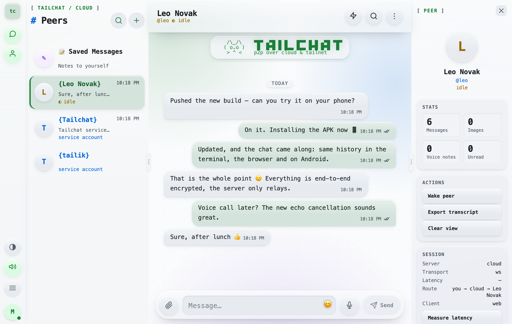

# Tailchat

End-to-end encrypted messenger with three clients that talk to each other:

- **Terminal** — a full-screen chat in your shell (`tailchat`).
- **Web / PWA** — the same account in a browser, installable on a phone or desktop.
- **Android** — a native app (Kotlin, Jetpack Compose) with calls and push notifications.

<picture>
  <source media="(prefers-color-scheme: dark)" srcset="docs/screenshots/web-dark.png">
  
</picture>

Two ways to connect:

- **Direct** — peer-to-peer between two machines on the same [Tailscale](https://tailscale.com)
  tailnet or LAN. No server, no account: `tailchat <peer>`.
- **Cloud** — accounts, contacts, offline delivery, history on every device and voice
  calls, through a server you host yourself.

[Русская версия](README.ru.md) · [Full manual (Russian)](docs/manual.md) · [Security model](SECURITY.md)

## Encryption

Messages, pictures, voice notes, replies and edits are encrypted end to end with
[vodozemac](https://github.com/matrix-org/vodozemac) (Olm/Megolm, as in Matrix) inside a
shared Rust core (`crates/`). Contacts are verified by a safety code. The server still sees
metadata — who, when, sizes, receipts, reaction emoji — and conversations with bots are not
encrypted. The web client is only as trustworthy as the server that serves it. Read
[SECURITY.md](SECURITY.md) before relying on it.

## Quick start: terminal, direct mode

Requires Node.js 22 or newer on both machines.

```bash
git clone https://github.com/repentandliveholy/tailchat-oss.git
cd tailchat
npm ci --omit=dev
npm link            # optional: puts `tailchat` on your PATH

# machine A                     # machine B
tailchat machine-b --name Alice  tailchat machine-a --name Bob
```

`machine-a`/`machine-b` are MagicDNS names or tailnet/LAN addresses. The default port is
`4747` (`--port` changes it). `tailchat --help` lists every flag; type `/help` inside the
chat for commands.

## Quick start: cloud mode

```bash
tailchat --cloud --cloud-server https://chat.example.org
```

The client offers to sign in or register, then shows your contacts. The same account works
in a browser at `https://chat.example.org/tailchat/` and in the Android app.

## Hosting a server

The server is one Node.js process (`bin/cloud-server.js`) behind a TLS reverse proxy.
[`docs/cloud-deploy.md`](docs/cloud-deploy.md) describes the deployment this project runs
(Caddy, PM2, a master key outside the data directory); `ecosystem.config.cjs` is the PM2
example. Settings worth knowing for a server open to strangers are listed in
[SECURITY.md](SECURITY.md#server-side-protections).

Environment variables of the server (`bin/cloud-server.js`); only the master key is required:

| Variable | Default | Meaning |
|---|---|---|
| `TAILCHAT_CLOUD_MASTER_KEY_FILE` | — (required) | 32-byte hex key, mode 0600, outside the data directory; it encrypts the store at rest (`bin/cloud-encrypt.js` initialises a directory) |
| `TAILCHAT_CLOUD_DATA` | `~/.tailchat-cloud` | Data directory |
| `TAILCHAT_CLOUD_HOST` / `TAILCHAT_CLOUD_PORT` | `127.0.0.1` / `7683` | Listen address |
| `TAILCHAT_CLOUD_TRUST_PROXY` | off | `1` behind a reverse proxy that sets `X-Forwarded-For`/`-Host`; a loopback bind refuses to start without it |
| `TAILCHAT_CLOUD_TURN_HOST` / `TAILCHAT_CLOUD_TURN_PORT` | unset / `3478` | Your coturn for calls: STUN there, and TURN when `turn_secret` (coturn's `static-auth-secret`) is in the data directory. Unset: public STUN, no relay |
| `TAILCHAT_CLOUD_VAPID_SUBJECT` | this project's address | Contact for web push (`mailto:` or `https:`); set your own |
| `TAILCHAT_CLOUD_PASSWORD_MIN` | `1` | Minimum password length |
| `TAILCHAT_CLOUD_TOKEN_IDLE_DAYS` | `0` (never) | Expire session tokens unused for this many days |
| `TAILCHAT_GITHUB_REPO` / `TAILCHAT_GITHUB_TOKEN` | unset | Where in-app bug reports become issues (the token can also be `github_token` in the data directory); without both, the service account says reports are not collected |
| `TAILCHAT_CLOUD_AI_OWNER` / `TAILCHAT_CLOUD_AI_GATEWAY_URL` | unset | Optional AI contact bridged to an OpenAI-compatible endpoint |
| `TAILCHAT_GATEWAY_HOST` / `TAILCHAT_GATEWAY_PORT` / `TAILCHAT_GATEWAY_SSH_HOST` / `TAILCHAT_GATEWAY_SSH_PORT` | `127.0.0.1` / `7681` / `127.0.0.1` / `7682` | Optional browser-terminal gateway (`bin/gateway-server.js`) |

Current limits, stated honestly: the whole store is held in memory and checkpointed as one
file, which suits a circle of friends, not a public service with open registration. Accounts
cannot yet be deleted from the clients.

## Android

The app lives in [`android/`](android/README.md). Build it with `./gradlew assembleDebug`;
a signed release needs your own keystore (`android/local.properties`, see
`android/app/build.gradle.kts`).

## Repository layout

| Path | What |
|---|---|
| `src/`, `bin/` | Terminal client, cloud server (`src/cloud/`), gateway |
| `web/cloud/` | Web/PWA client |
| `android/` | Native Android client |
| `crates/` | Rust core: protocol, E2EE, storage; built for Node, the web (wasm) and Android |
| `bots/`, `packages/` | Bots that appear as ordinary contacts, and their shared code |
| `docs/` | Manual, specifications (`docs/specs/`), deployment notes |
| `test/` | `node --test` suite |

## Development

```bash
npm ci
node --test                     # JavaScript suite
(cd crates && cargo test --workspace && cargo clippy --workspace)
(cd android && ./gradlew testDebugUnitTest)
```

See [CONTRIBUTING.md](CONTRIBUTING.md).

## License

[MIT](LICENSE) for the code. The web client's emoji images (`web/cloud/emoji/apple/`) are
Apple's artwork, © Apple Inc., taken from [emoji-data](https://github.com/iamcal/emoji-data);
they are **not** covered by the MIT licence. If you redistribute or fork this project,
regenerate them from another set with `bin/make-emoji-data.js`.
