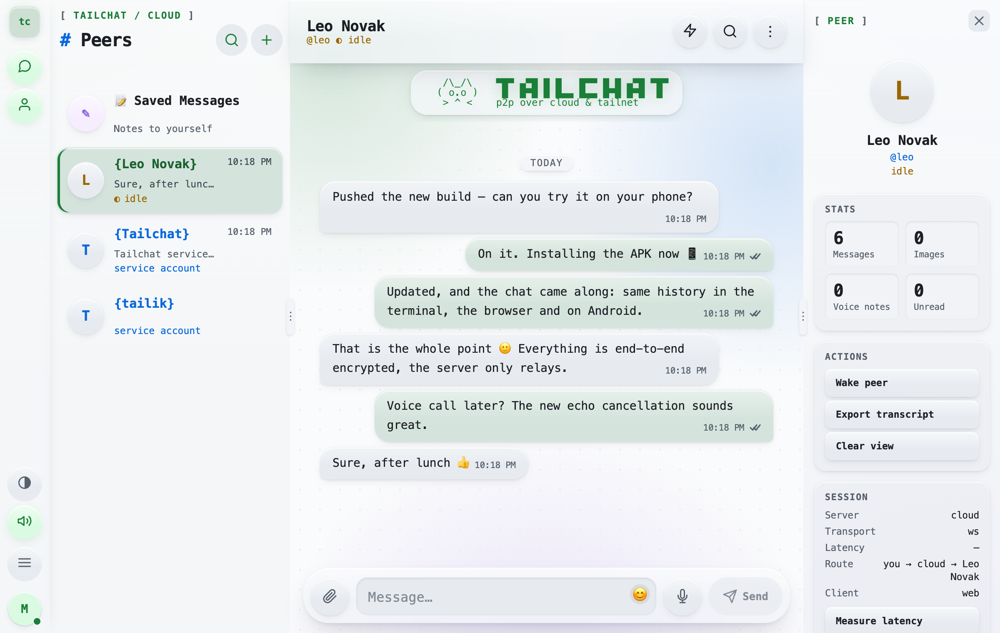

# Tailchat

Мессенджер со сквозным шифрованием и тремя клиентами, которые говорят друг с другом:

- **Терминал** — полноэкранный чат прямо в оболочке (`tailchat`).
- **Веб / PWA** — тот же аккаунт в браузере, ставится на телефон или компьютер.
- **Android** — нативное приложение (Kotlin, Jetpack Compose) со звонками и push-уведомлениями.

<picture>
  <source media="(prefers-color-scheme: dark)" srcset="docs/screenshots/web-dark.png">
  
</picture>

Два способа соединения:

- **Напрямую** — P2P между двумя машинами в одном [Tailscale](https://tailscale.com)-tailnet
  или локальной сети. Без сервера и аккаунта: `tailchat <собеседник>`.
- **Облако** — аккаунты, контакты, доставка выключенному собеседнику, история на всех
  устройствах и голосовые звонки через сервер, который вы разворачиваете сами.

[English](README.md) · [Полное руководство](docs/manual.md) · [Модель безопасности](SECURITY.md)

## Шифрование

Текст, картинки, голосовые, ответы и правки шифруются сквозным образом
[vodozemac](https://github.com/matrix-org/vodozemac) (Olm/Megolm, как в Matrix) в общем
ядре на Rust (`crates/`). Собеседник сверяется кодом безопасности. Сервер по-прежнему видит
метаданные — кто, когда, размеры, квитанции, эмодзи реакций; беседы с ботами не шифруются.
Веб-клиент надёжен ровно настолько, насколько надёжен сервер, который его раздаёт.
Подробности — в [SECURITY.md](SECURITY.md).

## Быстрый старт: терминал напрямую

Нужен Node.js 22 или новее на обеих машинах.

```bash
git clone https://github.com/repentandliveholy/tailchat-oss.git
cd tailchat
npm ci --omit=dev
npm link            # необязательно: команда `tailchat` в PATH

# машина A                       # машина B
tailchat machine-b --name Alice  tailchat machine-a --name Bob
```

`machine-a`/`machine-b` — MagicDNS-имена или адреса в tailnet/локальной сети. Порт по
умолчанию `4747` (`--port`). Все флаги — `tailchat --help`, команды в чате — `/help`.

## Быстрый старт: облако

```bash
tailchat --cloud --cloud-server https://chat.example.org
```

Клиент предложит вход или регистрацию и покажет контакты. Тот же аккаунт открывается в
браузере по `https://chat.example.org/tailchat/` и в приложении Android.

## Свой сервер

Сервер — один процесс Node.js (`bin/cloud-server.js`) за обратным прокси с TLS.
[`docs/cloud-deploy.md`](docs/cloud-deploy.md) описывает развёртывание проекта (Caddy, PM2,
мастер-ключ вне каталога данных); `ecosystem.config.cjs` — пример для PM2. Настройки для
сервера, открытого посторонним, перечислены в [SECURITY.md](SECURITY.md#server-side-protections).

Переменные окружения сервера (`bin/cloud-server.js`); обязателен только мастер-ключ:

| Переменная | По умолчанию | Назначение |
|---|---|---|
| `TAILCHAT_CLOUD_MASTER_KEY_FILE` | — (обязательна) | Ключ 32 байта hex, права 0600, вне каталога данных; шифрует хранилище на диске (каталог готовит `bin/cloud-encrypt.js`) |
| `TAILCHAT_CLOUD_DATA` | `~/.tailchat-cloud` | Каталог данных |
| `TAILCHAT_CLOUD_HOST` / `TAILCHAT_CLOUD_PORT` | `127.0.0.1` / `7683` | Адрес прослушивания |
| `TAILCHAT_CLOUD_TRUST_PROXY` | выкл. | `1` за обратным прокси, который сам ставит `X-Forwarded-For`/`-Host`; на loopback без неё сервер не стартует |
| `TAILCHAT_CLOUD_TURN_HOST` / `TAILCHAT_CLOUD_TURN_PORT` | не задана / `3478` | Ваш coturn для звонков: STUN там же, TURN — если в каталоге данных лежит `turn_secret` (`static-auth-secret` coturn). Не задана — публичный STUN, без релея |
| `TAILCHAT_CLOUD_VAPID_SUBJECT` | адрес этого проекта | Контакт для web push (`mailto:` или `https:`); задайте свой |
| `TAILCHAT_CLOUD_PASSWORD_MIN` | `1` | Минимальная длина пароля |
| `TAILCHAT_CLOUD_TOKEN_IDLE_DAYS` | `0` (никогда) | Токены, не использованные столько дней, истекают |
| `TAILCHAT_GITHUB_REPO` / `TAILCHAT_GITHUB_TOKEN` | не заданы | Куда баг-репорты из приложения уходят issue (токен можно положить и файлом `github_token` в каталог данных); без обоих служебный аккаунт честно отвечает, что репорты не собираются |
| `TAILCHAT_CLOUD_AI_OWNER` / `TAILCHAT_CLOUD_AI_GATEWAY_URL` | не заданы | Необязательный ИИ-контакт через OpenAI-совместимый endpoint |
| `TAILCHAT_GATEWAY_HOST` / `TAILCHAT_GATEWAY_PORT` / `TAILCHAT_GATEWAY_SSH_HOST` / `TAILCHAT_GATEWAY_SSH_PORT` | `127.0.0.1` / `7681` / `127.0.0.1` / `7682` | Необязательный шлюз терминала в браузере (`bin/gateway-server.js`) |

Честно об ограничениях: всё хранилище держится в памяти и сохраняется одним файлом — это
подходит для круга знакомых, а не для публичного сервиса с открытой регистрацией. Удалить
аккаунт из клиентов пока нельзя.

## Разработка

```bash
npm ci
node --test
(cd crates && cargo test --workspace && cargo clippy --workspace)
(cd android && ./gradlew testDebugUnitTest)
```

См. [CONTRIBUTING.md](CONTRIBUTING.md).

## Лицензия

[MIT](LICENSE) — для кода. Картинки эмодзи веб-клиента (`web/cloud/emoji/apple/`) — графика
Apple, © Apple Inc., взяты из [emoji-data](https://github.com/iamcal/emoji-data); лицензия MIT
на них **не** распространяется. Для форка или распространения пересоберите их из другого набора
через `bin/make-emoji-data.js`.
