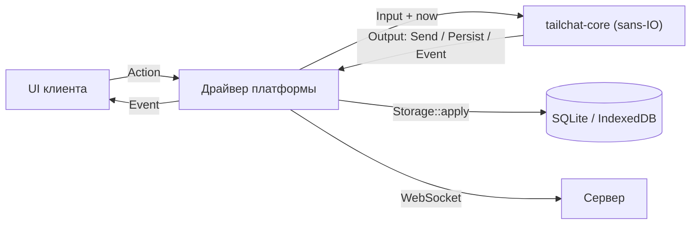

# Rust-ядро Tailchat — спецификация

Статус: этапы 0–5 и этап 6 (E2EE, подэтапы 6a–6f) реализованы и проверены в
рабочем дереве (этап 5 — 2026-11-04; 6a–6c — 2026-11-05; ревью 6a–6c и 6d —
2026-11-06; 6e и 6f — 2026-11-07: терминал на ядре под флагом `TAILCHAT_CORE=1`
со сквозным шифрованием и бэкапом ключей). Этап 7, шаг 3 (веб на WASM): ядро,
драйвер и хранилище браузера готовы и проверены (2026-11-11, `56afc47`, `1b510ff`);
`web/cloud/app.js` на ядро ещё не переведён, APK ядро не использует.
`01a19351` (2026-10-31) и блок вопросов 2026-11-01.

## 0. Решения владельца

| Вопрос | Решение |
|---|---|
| Объём | Полное ядро, по этапам (§4) |
| Ввод-вывод | Sans-IO ядро + отдельный нативный драйвер |
| Хранилище | В ядре: трейт `Storage` + SQLite (SQLCipher) |
| Первый клиент | Терминал (Node, napi-rs) |
| Каркас | Владелец руками пишет только суть: `receipt.rs` (лестница §12), `api.rs` (контракт ядра), `engine.rs` (`Core::handle`); остальное каркаса — из проверенного черновика; модули — субагенты (сокращено владельцем 2026-11-02) |
| Криптография | vodozemac (Olm/Megolm), своих примитивов нет |
| Сверка собеседника | Доверие при первом контакте + QR; смена ключа — заметное предупреждение |
| Превью ссылок | Собирает отправитель |
| Tailik | Шифрует как отдельное устройство |
| Push | С текстом, расшифровка на устройстве |
| История на новом устройстве | Как в Element: бэкап ключей под паролем |
| Терминал P2P | Тоже на ядро |
| Android | Пока Kotlin; на ядро — отдельным этапом |
| Терминал на ядре (этап 5) | Замена транспорта под флагом `TAILCHAT_CORE=1`: тот же объект `startCloudSession`, под ним нативный драйвер (2026-11-04) |
| Сборка нативного модуля | Локально: `npm run build:core` (нужен Rust); готовых бинарников и сборки при `npm install` нет |
| Ключ SQLCipher | HKDF-SHA256-подключ ключа устройства (`secure-store.js`, `info = "tailchat-core-sqlcipher-v1"`), без новой записи Keychain |
| Ключ устройства в браузере (этап 7) | Неизвлекаемый ключ WebCrypto AES-GCM-256 в самой IndexedDB, каждая запись зашифрована, ключи записей — HMAC неизвлекаемым ключом (`web/cloud/core/idb-storage.js`); аналог «SQLCipher + Keychain». Принято по рекомендации («делай как рекомендуешь»), 2026-11-11 |
| Веб на ядре (этап 7) | Исполнитель `tailchat_net::exec` общий с нативным драйвером (фича `native` выключена); цикл драйвера — Rust в WASM, ввод-вывод даёт страница объектом `host`; JSON уведомлений общий с терминалом (`tailchat_net::json`) |
| Доставка wasm на прод (этап 7) | Собирается на ноутбуке при релизе (`npm run build:web-core`) и едет в архиве/выкладке релиза; на сервере нет Rust и компиляторов. Решение владельца, 2026-11-11 («да и компилятор локально») |
| Веб на ядре под флагом (этап 7) | `?core=1` (запоминается в `localStorage`), `?core=0` выключает; одна вкладка на аккаунт держит ядро (Web Locks), остальные — классика; таблица маршрутизации общая с терминалом (`web/cloud/core/routing.js`) |
| E2EE (этап 6) | Ответы 2026-11-04 — `docs/specs/2026-11-04-e2ee.md` §1.2: порядок как в плане (6 до 7), авто-шифрование без молчаливого отката, боты без шифрования, Tailik только где включён, ключ восстановления + фраза, QR + SAS, реакции открыто |

### Передача следующему агенту

**Точка продолжения (2026-11-11, вечер) — этап 7, шаг 3 (веб на WASM) закончен и на проде;
дальше шаг 4 — APK через UniFFI.** Части 1–4 — как раньше (`56afc47`, `1b510ff`,
`2651671e`, `ed667eb9`: `web/cloud/core/`, `app.js` под `?core=1`, общие с терминалом
`e2ee-commands.js`/`e2ee-strings.js`). Часть 5 — доставка wasm: собирается на ноутбуке в
`bin/release-cloud.js` и отправляется на бокс после деплоя (на сервере не компилировать),
релиз 1.138. По живой проверке с реальным собеседником исправлены все 7 дефектов сверки:
1.139 (таймаут 45 с, одна сверка за раз, перепроверка устройств, свои устройства не в чужой
беседе), 1.140 (`StartSasAny` — один запрос всем подписанным устройствам), 1.141 (имена
устройств: `Core::set_device_name` → `name` в `keys/upload`, имена в событиях), 1.142
(простые слова). Подробности — верхние записи `docs/worklog.md`. **Дальше:** APK через
UniFFI — пока APK не объявляет ключей, беседы с ним идут открытым текстом
(`Decision::Plain`, `E2EE_LEGACY_WINDOW_MS`). Ниже — исходная передача
2026-11-07; UI-команды `/verify`, `/trust`, `/backup` с тех пор сделаны (`40e5ea4`).
Этапы 0–5 и весь этап 6 (6a–6f) реализованы и проверены в рабочем дереве:
контракты — `docs/specs/2026-11-04-e2ee.md` §8.1–8.6 и §11.2, верхняя запись
`docs/worklog.md` от 2026-11-07. Исходники в `crates/` и `src/cloud/core-link.js`
— фактическое состояние, а не временный черновик.

- **Ручной набор закончен.** Дальнейшую реализацию делает агент и кратко
  объясняет изменения. Каждый законченный шаг должен собираться.
- **Последняя выполненная проверка (2026-11-07):** подэтапы 6e + 6f в e2ee
  §8.5–8.6 (277 Rust-тестов + мутации M1–M4 + 1614 JS-тестов в `test/*.test.js`
  + живой смоук двух терминалов в `tmux` и восстановления бэкапа на третьем
  устройстве). После новых правок проверять новое состояние, не выдавать эту
  запись за свежий прогон.
- **Где включено шифрование:** в терминале под флагом `TAILCHAT_CORE=1`
  (`startCoreCloudSession` передаёт `e2ee: true` в собранный
  `native/tailchat_core.node`). По политике §7 беседа шифруется только тогда,
  когда все активные устройства обеих сторон объявили ключи (поэтому реальные
  аккаунты с открытыми сессиями веба/APK до этапа 7 остаются в открытом режиме).
  Без `TAILCHAT_CORE=1` терминал, веб и APK работают по-старому.
- **Открытые пределы этапа 5** (не блокируют этап 6, но их надо помнить):
  TLS драйвера (`wss`/`https` с корнями Mozilla) против настоящей цепочки
  прода **проверен 2026-11-10** — `crates/tailchat-net/src/live_tests.rs`
  (`#[ignore]`, анонимно: выдуманный токен, ожидаются `401` и кадр
  `auth_failed`; контроль — те же запросы с пустым хранилищем корней обязаны
  упасть до HTTP), запуск `cargo test -p tailchat-net live_ -- --ignored`;
  HTTP-клиент истории свой (без редиректов, прокси и gzip — Caddy прода ни
  того, ни другого не требует, `401` прочитан этим клиентом); сборка на
  Linux/Windows не проверялась; `blocked`/`not_subscribed` приходят без
  `peer`/`id`, поэтому ⚠ у получателя из ростера, который заблокировал, —
  только по правилу 8 попыток (минуты).
- **Эталон семантики `StoreOp`** — `crates/tailchat-core/tests/common/mod.rs`
  (`MemStore`). `tailchat-store/tests/conformance.rs` подключает этот же файл
  (`#[path]`) и сверяет с ним SQLite: меняя `StoreOp`, менять оба, тест покажет
  расхождение.
- **Сохранить контракты этапов 2–3:** Persist до Send; ошибка Storage прерывает
  пачку; SendFailed возвращает попытку или квитанцию; watermark не подтверждает
  очередь; курсор ленты и долг — в одном Persist; `ack` — только после того, как
  строка в Persist. Подробности ниже.
- **Безопасность работы:** только временные аккаунты/локальный сервер,
  не production и не реальные устройства. Живые проверки терминала — с
  временным `HOME`, подменой `security` (настоящий Keychain не трогать) и
  без LAN-маяков. Не откатывать и не включать посторонние изменения владельца
  в свою работу. Разрешения на коммит, push или deploy не было.
- **Субагенты:** перед запуском прочитать локальные
  `~/.omp/agent/AGENTS.md` и `~/.omp/agent/SUBAGENTS.md`, согласовать запуск
  по их правилам. Настройки моделей в прошлой сессии были session-only:
  не предполагать, что они перенеслись.

## 1. Зачем

Три клиента реализуют одну и ту же логику по-разному
(разведка 2026-11-01 по `src/cli.js`, `web/cloud/app.js`, `SyncEngine.kt`):

- `⚠` есть в вебе и APK, в терминале нет (`src/ui.js:118`, `src/cli.js:1310`);
- повтор отправки: терминал 3 с/20 с, веб 3 с, APK — backoff до 5 мин и 8 попыток;
- `store_failed`: веб сразу ставит `⚠`, APK повторяет;
- лимит очереди: 50 / 500 / без лимита;
- дыры в истории: APK докачивает по `backfillJson`, веб и терминал берут одну
  страницу `/api/history` — глубже 100 сообщений теряется;
- `ack` из `sync-page`: APK шлёт, веб — только при `last`, терминал — нет.

Ядро делает это один раз. Рассинхрон из-за сервера (потерял до fsync) и P2P
мимо облака ядро не лечит.

## 2. Архитектура



- **`tailchat-core`** — чистая машина состояний: `Core::handle(now, Input) ->
  Result<Vec<Output>, CoreError>`. Нет сети, диска, часов, потоков, случайности:
  время приходит как `now`, id нового сообщения — в `Action::SendText`
  (`MessageId::from_random` от байтов ОС, которые даёт драйвер). Единственное
  исключение — `tailchat-crypto` (этап 6): vodozemac берёт случайность из ОС
  сам, поэтому байты ключей и шифротекста недетерминированы; тесты проверяют
  расшифрованный смысл (e2ee §6). `Core` не
  generic — napi-rs и UniFFI экспортируют его без обёрток.
- **`Err` только за ошибку вызывающего** (пустой текст). Плохие данные от
  сервера — никогда не `Err`: кадр отбрасывается с `Event::BadFrame`, соединение
  живёт; отказ сервера (`{k:"error"}`) — `Event::ServerError{code, peer, id}`.
- **Порядок выходов обязателен.** `Output::Persist` применяется атомарно и
  durably до любого следующего `Output::Send`: сообщение на диске раньше, чем в
  сокете. Если `Storage::apply` не удался, драйвер отбрасывает остаток пачки и
  пересоздаёт ядро из `Storage::load()` — ядро не может обогнать диск.
- **Драйвер** — по одному на платформу: `tailchat-node` (napi-rs, первый),
  позже WASM для веба и UniFFI для Android. Нативный драйвер с tokio +
  WebSocket — отдельный крейт `tailchat-net`. Драйвер ставит максимальный размер
  кадра WebSocket = `MAX_INBOUND`, чтобы больший кадр отсекался до выделения
  памяти.
- **`Storage`** — трейт `apply(&[StoreOp])` (всё или ничего) + `load() ->
  Snapshot`. Нативная реализация — `tailchat-store` на rusqlite/SQLCipher.
  Ядро трейт не вызывает: его вызывает драйвер. Ключ сообщения — **`(peer,
  id)`**: сервер уникален по id только внутри беседы (`findHistoryMessage(login,
  to, id)`).

## 3. Безопасность и скорость

- `unsafe_code = "forbid"` во всём workspace. Крейты-обёртки FFI (napi-rs,
  UniFFI) **не наследуют** `[lints] workspace = true`: их сгенерированный
  `unsafe` иначе не соберётся; своего `unsafe` в них нет.
- `unwrap`/`expect`/`panic`/`todo`/`unimplemented`/индексация `[i]`/`as`
  запрещены clippy вне тестов.
- Всё, что приходит из сети, сначала ограничивается по размеру
  (`MAX_INBOUND`), потом парсится; типы с инвариантом (`Login`, `MessageId`,
  `Token`) создаются только через `parse`.
- Токен — `Zeroizing`, `Debug` его не печатает. Честная граница: копия токена
  уходит в кадр `auth` (`Output::Send`), её стирание — забота драйвера.
  `Debug` у `Input`/`Outgoing` печатает текст сообщения — такие значения не
  логировать.
- Неизвестный `k` от сервера — не ошибка (совместимость с новым сервером).
- `overflow-checks = true` и LTO в release.
- Без async и без аллокаций сверх необходимого в горячем пути; JSON —
  `serde_json`.

## 4. Этапы

| # | Этап | Кто | Готово, когда |
|---|---|---|---|
| 0 | Каркас: workspace, ошибки, `Login`, `MessageId`/`Ts`/`Seq`, лестница меток, API, трейты, `Core` с путём «отправить → ✓» | владелец (`receipt.rs`, `api.rs`, `engine.rs`) + готовые файлы | `cargo test` + `clippy -D warnings` зелёные |
| 1 | Кодек кадров: типизированные конверты сервера, кодирование исходящих кадров, лимиты | CoreCodec | Сделано: декодирование реальных кадров; неизвестные типы допускаются. Calls/file/rtc пока `Unknown`, см. границы ниже |
| 2 | Outbox: повторы с backoff, лимит, `⚠`, `retry`, ватермарки `readTs`/`deliveredTs` | основной ассистент, по выбору владельца после неудачного урока | Сделано в крейте; живые сокеты + файловое восстановление, 85 тестов всего |
| 3 | Синхронизация: `sync`/`sync-page`, `reset`, долг докачки по id, `ack` из ленты | основной ассистент | Сделано: дыра 2100 сообщений и два `reset` закрыты живьём с падением посреди докачки; 99 тестов всего |
| 4 | `tailchat-store` (SQLite/SQLCipher) | основной ассистент | Сделано: сверка с `MemStore` на случайных пачках, SIGKILL посреди записи, шифрование файла; 106 тестов всего |
| 5 | `tailchat-node` + `tailchat-net`, подключение терминала | субагенты (Sonnet, Terra, Gemini) + ревью основного ассистента | Сделано: терминал под `TAILCHAT_CORE=1` на изолированном сервере — отправка, ✓, ✓✓, ⚠, докачка, офлайн-очередь; 163 Rust + 1608 JS тестов |
| 6 | E2EE: vodozemac, реестр устройств на сервере, TOFU + QR, бэкап ключей | основной ассистент; security-review после 6c | `docs/specs/2026-11-04-e2ee.md` §8: 6a–6c (2026-11-05), ревью 6a–6c + 6d (2026-11-06), дальше 6e–6f |
| 7 | Веб (WASM), затем Android (UniFFI) | субагент | §11/§13 по всем поверхностям |

Политика outbox этапа 2 — решение владельца 2026-11-02 (одна для всех клиентов):

| Вопрос | Решение |
|---|---|
| Повтор без `message-accepted` | Нарастающая пауза 1 → 2 → 4 … с, плюс разброс до 25%, общий потолок 5 мин. После `ready` очередь доступна сразу, но отправляется с темпом ≤30 кадров/с. Переподключение сбрасывает паузу, не расходуя и не обнуляя сохранённый бюджет попыток |
| Когда `⚠` | Офлайн попытки не считаются: без соединения сообщение ждёт `⧗` сколько угодно. `⚠` — при отказе навсегда или после 8 попыток при живом соединении без `message-accepted` |
| Отказ навсегда → `⚠` сразу | `message_id_conflict`, `blocked`, `peer_not_found`, `frame_too_large`; получатель не в ростере (вместо `not_subscribed`, который приходит без id) |
| `store_failed` | Повтор с паузой, как любой временный сбой; `⚠` только по правилу 8 попыток |
| `throttle` / `rate_limited` | Не `⚠`: притормозить |
| Предел очереди | 1000 на беседу; при переполнении новое сообщение не принимается (`Err`, человек видит ошибку), старые никогда не выбрасываются |
| Темп отправки | Не больше 30 кадров/с (сервер режет > 60, квитанции считаются) — решено технически |
| «Повторить» | Тот же `id`: сервер идемпотентен (`hub.js:1840`) |

Обязательно для этапа 2, найдено ревью и живой проверкой каркаса:
- **темп отправки**: сервер пропускает 60 кадров в секунду (`hub.js`,
  `frameRateLimit`), лишние отбрасывает с `throttle`. `flush` после `ready` не
  может слать всю очередь разом — нужен темп, `Input::Tick` и `next_wakeup()`;
- **`not_subscribed` приходит без `peer`/`id`** (проверено на локальном сервере:
  отправка не-другу). Связать отказ с сообщением нельзя, поэтому получателя
  проверять по ростеру до отправки, иначе сообщение повторяется при каждом
  переподключении;
- `message_id_conflict`/`store_failed` несут `peer` и `id`
  (`hub.js:1844,1864`) — их можно привязать к сообщению.

Для этапа 1 (кодек): `ts`/`seq` во входящих событиях декодировать терпимо
(сервер пропускает любое конечное число, `accounts.js` `normalizeEvent`), плохое
событие пропускать, а не валить всю `sync-page`.

### Контракт этапа 2 (реализован)

- В `outbox.rs` очередь обслуживается по кругу: повтор в начале не вытесняет
  новые сообщения в конце. За один проход выдаётся максимум один кадр, между
  кадрами минимум 34 мс. Точный срок следующего вызова возвращает
  `Core::next_wakeup()`; драйвер пересчитывает таймер после каждого входа.
- Попытка и срок следующей попытки сохраняются до `Send`. После восьмой записи
  в сокет ядро ещё ждёт подтверждение до её срока; затем ставит `Failed`.
  `Retry` сохраняет прежние id, текст и timestamp, обнуляя только бюджет.
- Разброс задержки выводится из случайного id сообщения, peer и номера попытки:
  это только планирование, не криптография. Ядро не обращается к ОС за энтропией.
- `Snapshot.pending` содержит `PendingOutgoing` с сообщением, счётчиком и сроком.
  `Snapshot.sent` содержит подтверждённые исходящие, `Snapshot.receipts` —
  долговечные позиции доставки/прочтения. Ключ каждой строки — `(peer,id)`.
- `PutPending` сохраняет строку очереди; `SetAttempt` меняет только её метаданные.
  `PutOutgoing` сохраняет подтверждённую строку и атомарно удаляет её из очереди.
  `PutPeerReceipts` сохраняет merged-watermarks. Ошибка применения пачки требует
  остановить обработку её остатка и пересоздать ядро из диска.
- Если сам сокет отказался принять запись, драйвер останавливает пачку и
  передаёт `Input::SendFailed {peer,id}`: попытка возвращается, таймеры выключены
  до нового `ready`. Это отличается от неопределённой доставки после обрыва.
- `Input::PeerReceipts` принимает позиции из `/api/history`; живые `ack/read`
  приходят через `Input::Frame`. Ни очередь, ни `Failed` не получают галочки по
  чужой ватермарке, пока собственный `message-accepted` не задаст серверный `ts`.
  Read подразумевает Delivered; ни позиция, ни метка не идут назад.
- Отказ auth передаётся драйверу как `ServerError`, таймеры отправки выключаются.
  Драйвер не должен переподключаться со старым токеном в бесконечном цикле.
- Реальный сервер шлёт живые квитанции только подписанному сокету
  (`hub.js:1283`): драйвер выбранной беседы должен выполнить `subscribe`.
  Квитанции неактивных бесед восстанавливаются из истории/ленты (этап 3).

Проверка этапа 2: `cargo build`, 85 тестов, clippy с `-D warnings`,
`cargo fmt --check`, rustdoc с запретом предупреждений. Одноразовый Rust-драйвер
на настоящих WebSocket и файловом `Storage` с `fsync`/rename: две офлайн-строки
восстановлены; первое подтверждение намеренно пропущено; повтор не создал дубль;
настоящие `ack/read` дали Delivered/Read и пережили чтение с диска; настоящий
`message_id_conflict` дал Failed. `/api/history` подтвердил по одной записи на id
и сохранённые read/delivered-позиции.

Пределы проверки: постоянного драйвера/SQLite ещё нет. `store_failed`, отказ
локального сохранения, лимит 1000, восемь попыток и pacing проверены
детерминированными поведенческими тестами, не повреждением настоящего сервера.
Один fixture кодека (`error-store-failed`) синтетический, остальные 61 сняты
с локального сервера. Этап 1 не реализует бизнес-логику calls/file/rtc/reminders.

### Контракт этапа 3 (реализован)

Серверные факты, на которых он стоит (проверены по коду и живьём):
- `seq` — общий счётчик сервера (`accounts.js` `nextSeq`) для всех аккаунтов:
  скачок в ленте одного аккаунта — чужое событие, **не дыра**. Дыра — только
  то, что сервер называет `reset` (курсор старше окна в 2000 событий).
- Событие `message` в ленте несёт только `id/ts/from`: текст и вложения есть
  только в `/api/history`. Живой `msg` приходит лишь сокету, подписанному на
  беседу (`hub.js` `deliverFrame`); остальным — `sync-nudge` (кап `sync-nudge-v1`,
  ядро теперь его объявляет) и лента.
- `/api/history` пагинируется парой `before` + `beforeId`, сортирует по `ts`,
  отдаёт удалённые для всех как надгробия только с `deleted=1`.

Поведение ядра:
- После `ready` с `sync-v1` — `sync` от курсора, страницы до `more:false`;
  `sync-nudge` во время страницы — ещё один запрос после неё. События с
  `seq ≤ cursor` не применяются повторно, курсор не идёт назад.
- Одна страница — **один Persist**: её эффекты, новый долг и `SetCursor`.
  `message`, которого устройство не держит (чужое или наше с другого
  устройства), — долг `(peer,id)` в `Backfill.owed`. `edit` применяется, только
  если новее локального `edited_at`; `delete` убирает строки, снимает долг и
  запоминает id на сессию, чтобы старая страница истории его не вернула;
  `react` — `SetReaction`; `read` с `self` — своя позиция (`PutOwnRead`), без
  `self` — ватермарка собеседника (✓✓). `message` с `self` для строки из
  очереди — доказательство коммита, если `message-accepted` потерялся.
- `reset`: каждой известной беседе (ростер, себе, беседы с строками) ставится
  `reseed` — полное перечитывание от новых к старым, позиция (`WalkFrom::Below`)
  сохраняется после каждой страницы и переживает перезапуск. Полное, а не до
  первого совпадения: правки и удаления старых сообщений внутри дыры иначе
  не увидеть.
- Докачка — после прохода ленты, по одной беседе и одному запросу за раз
  (`Output::Fetch(HistoryRequest)` → `Input::History`/`HistoryFailed`, сверка по
  `serial`). Сначала долг по id: обход от новой страницы вниз ищет id, бывшие
  долгом **на старте обхода**; найденные снимаются сразу, а дошедший до начала
  беседы обход снимает оставшиеся как отсутствующие (скрыты для этого
  аккаунта или срезаны удалением контакта). Id, ставшие
  долгом позже, получают свой обход от новой страницы. Затем `reseed`.
- Строку, которую устройство уже держит, история меняет только более новой
  правкой; набор реакций — только при `reseed`, и страница перезапрашивается
  (до 3 раз), если во время запроса пришла реакция в этой беседе.
- Ошибки: сеть/5xx — пауза 5 с, удвоение до 5 мин (`next_wakeup`); тело больше
  `MAX_INBOUND` — та же позиция с половиной страницы; 400/403 — долг беседы
  неоплатим и снимается; 401 — запросов нет до нового `ready`.
- `ack`: только после того, как строка в Persist (живой `msg` или найденная в
  истории), один на собеседника — самое новое входящее, долговечно
  (`PutAck`/`DropAck`), с тем же темпом 34 мс, что и сообщения, впереди них;
  отказ сокета или `throttle` возвращают его в долг. Нижняя граница «уже
  подтверждено» живёт в памяти: после перезапуска возможен один лишний `ack`
  на более старое сообщение (сервер его игнорирует).
- События UI не копируют тела: `MessageStored{peer,id}` — перечитать строку из
  хранилища; `MessagesRemoved`, `OwnReadMoved`.
- Живые `edit/del/react` с сокета не применяются: их приносит лента по
  `sync-nudge` (~250 мс), один путь вместо двух.

Проверка этапа 3: 99 тестов (10 сценариев `tests/sync.rs` против модели
`eventsSince`/`history` сервера с перезапусками; 4 теста кодека истории),
clippy `-D warnings`, `cargo fmt --check`, rustdoc. Живьём — изолированный
сервер 127.0.0.1:7699, временные alice/bob/carol, одноразовый Rust-драйвер
(tungstenite + HTTP/1.1 по TCP, файловое хранилище с fsync/rename), сверка
с `/api/history` после каждого шага: (1) первая синхронизация; (2) 150
пропущенных от bob, правка/удаление/реакция старых, 10 от carol, 2 своих из
«браузера», падение после первой страницы истории и продолжение; (3) 2100
пропущенных → `reset`, правка и два удаления в дыре, падение посреди долга;
(4) ещё 2100 → второй `reset`, падение посреди `reseed` (на диске позиция
`Below deep-1100`), продолжение с неё. Итог: 4353 + 10 строк, совпадение по
тексту, `editedAt`, реакциям и автору, ни одной вставки дважды, долг и
`ack` пусты.

Пределы: медиа в живой проверке не было (кодек и `Message` их несут, тесты —
нет). Скрытие (`scope:self`) с другого устройства внутри дыры `reset` не
убирает строку локально: история её просто не отдаёт, а надгробия у скрытия нет.
Гонка «реакция во время запроса страницы долга» на уже хранимой строке
исключена тем, что такие страницы реакций хранимых строк не трогают.

### Контракт этапа 4 (реализован)

`crates/tailchat-store`: `SqliteStore::open(path, &Key)` + `impl Storage`.

- **Шифрование.** rusqlite `bundled-sqlcipher`: SQLCipher собирается из
  исходников, на Apple — с CommonCrypto, на Linux — с системным libcrypto
  (нужен OpenSSL dev; на Linux сборка ещё не проверялась). `Key` — 32 байта,
  передаются как raw-ключ (`PRAGMA key = "x'…'"`, без KDF пароля); где их
  хранить (Keychain/Keystore/файл с правами 0600) — решение драйвера этапа 5.
  `open` отказывает: `NotSqlCipher`, если SQLite собран без шифрования (пустой
  `cipher_version`), `WrongKey`, если ключ не открывает файл, `NewerSchema`,
  если `user_version` новее этой сборки. Честная граница: SQLite держит копию
  строки `PRAGMA key` до finalize и не стирает её; SQLCipher держит ключ, пока
  файл открыт. `Key`/ошибки ключ и текст сообщений не печатают.
- **Атомарность и durability.** Пачка — одна транзакция `BEGIN IMMEDIATE`;
  ошибка любого op откатывает всю пачку (`SetAttempt` без строки очереди —
  `MissingPending`). WAL, `synchronous = FULL`, `fullfsync` и
  `checkpoint_fullfsync` (на Apple `F_FULLFSYNC`, иначе no-op). Цена на этом
  Mac: одна запись очереди — p50 4.7 мс, p95 6.9 мс (release).
- **Схема 1** (`schema.rs`): `cursor`, `pending`, `sent`, `messages`,
  `peer_receipts`, `backfill`, `own_reads`, `acks`; ключ `(peer,id)` или
  `peer`. Списки, по которым не ищут (реакции, кнопки, долг по id), — JSON.
  Медиа хранятся в строке целиком, как в `Message`.
- **Порядок.** `pending` и `sent` хранят `ord`: upsert переносит строку в
  конец, как `MemStore`, — с этого порядка round-robin outbox продолжает после
  перезапуска. `held` — сначала строки беседы по `(peer,id)`, затем `sent`.
  Позиции по собеседнику — по `peer` (ядро кладёт их в карты).
- **Чтение для UI:** `message(peer,id)` — строка беседы (после
  `Event::MessageStored`), `sent(peer,id)` — подтверждённая исходящая с её
  `edited_at` и реакциями. Список беседы — `conversation` (этап 5).
- **Один процесс на файл.** Два ядра на одном файле разойдутся в памяти;
  блокировку экземпляра делает драйвер (этап 5).

Проверка этапа 4: `tests/conformance.rs` — 3 сида × 600 случайных пачек
всех 15 `StoreOp` в `MemStore` и SQLite сразу: одинаковый исход (`Ok`/`Err`),
`Snapshot` и каждая строка `message`/`sent` после каждой пачки и после
переоткрытия; генератор проверен мутациями (5 из 5 намеренных ошибок в
`apply.rs` пойманы). `tests/kill.rs` — дочерний процесс пишет пачки (24 строки
беседы + очередь + курсор), его 8 раз убивают SIGKILL в разные моменты: всё,
о чём он отчитался, на диске, каждая пачка целиком или никак (тест падает,
если коммитить по одному op). `tests/cipher.rs` — текст не встречается ни в
файле, ни в WAL, ни в `-shm`, ни открытым, ни после закрытия; чужой ключ —
`WrongKey` без изменений; новая схема — `NewerSchema`. Одноразово: все 10
сценариев `tailchat-core/tests/sync.rs` (с перезапусками ядра) прогнаны через
обёртку, писавшую каждую пачку в `MemStore` и SQLite и восстанавливавшую ядро
из SQLite, — совпадение после каждой из 63 пачек, до 457 строк.

Пределы: kill процесса не равен отключению питания — durability при обрыве
питания следует из `synchronous = FULL`/`F_FULLFSYNC`, но не испытана. Сборка
на Linux/Windows не проверялась. Миграции: только 1 → 2 (этап 5, индексы).

### Контракт этапа 5 (реализован)

`crates/tailchat-net` (драйвер), `crates/tailchat-node` (napi-rs 3),
`src/cloud/core-link.js` и терминал под флагом.

Драйвер, `tailchat_net::start(Config, sink) -> Handle`:
- Один поток ОС `tailchat-net` с current-thread tokio владеет `Core` и
  `SqliteStore` (с `Handle::conversation` делит его через `Mutex`). Всё, что
  может упасть по вине вызывающего, падает в `start`, до потока:
  `StartError::{BadToken, BadUrl, Locked, Store, Io}`.
- Один процесс на файл: `File::try_lock` на `<db>.lock`; база закрывается до
  снятия блокировки.
- Исполнитель (`exec.rs`): выходы строго по порядку, Persist durable до любого
  следующего Send. Ошибка Persist — остаток пачки отброшен, `StorageFailed`,
  ядро пересобрано из `load()` (не прочиталось — ядро «stale» и входов не
  получает до пересборки перед следующим dial). Отказ записи в сокет — остаток
  пачки отброшен (кроме `Fetch`), `Input::SendFailed` по `frames::send_key`
  (иначе `Disconnected`), сокет закрыт. Каждый `Fetch` отвечен ровно раз.
- `Notice::ActionRefused {peer, id, held, reason}` называет сообщение действия:
  пустой текст, полная очередь, повтор id, retry не ⚠-строки, недоступное
  хранилище или хранилище, упавшее раньше, чем строка действия легла на диск.
  После `MessageAdded`/`ReceiptChanged` своего действия отказа нет: строка на
  диске и уйдёт. `held` — `SendText` с id, который ядро уже держит: нового
  ничего, сообщение существует.
- Сокет: кадр и сообщение не больше `MAX_INBOUND`, бинарные кадры не читаются;
  сторожок — 35 с тишины по стенным часам (сервер пингует раз в 12 с, сон
  ноутбука замечается при первой проверке); redial 1 → 30 с, сброс после
  `ready`; `auth_failed`/`auth_required` — `AuthFailed`, без повторов до
  `Command::Reconnect`.
- История — свой HTTP/1.1 GET (rustls + корни Mozilla, bearer,
  Content-Length/chunked/до закрытия, тело считается против `MAX_INBOUND` по
  мере чтения, 30 с, только 200; без редиректов и прокси, `identity`).
- `Command::Raw` пишется как есть только после `ready`, иначе `RawDropped`.
  Уведомления — на потоке драйвера, по порядку; после `stop()` — ни одного;
  `stop()` ждёт выхода потока (из sink — только сигнал).
- `extra_caps` → `Core::set_extra_caps` → `frames::auth_with`: терминал
  заявляет caps link.js (`read-ack-v1` и др.), иначе hub не шлёт ему
  `read-accepted`.

Хранилище, дополнение: схема 2 — индексы `(peer, ts, id)` трёх таблиц,
миграция 1 → 2; `SqliteStore::conversation(peer, before, limit)` →
`Row::{Message, Sent, Pending}`: новейшие `limit` строго старше `before` по
`(ts, id)`, от старых к новым; один ключ — одна строка (`sent` > `messages` >
`pending`).

Node: `native/tailchat_core.node` собирает `npm run build:core`
(`bin/build-core.js`). `open(options, onNotice)` → `Client {sendText, retry,
sendRaw, reconnect, conversation, close}`; уведомления — объекты с `kind`,
через ThreadsafeFunction, по порядку, после `close()` — ни одного. Ошибки
`open` несут `code`: `locked`, `store`, `bad-token`, `bad-url`. Ключ копируется.

Терминал, `TAILCHAT_CORE=1`:
- `startCoreCloudSession` отдаёт объект link.js, а не его копию: link.js
  получает WebSocket-подобный `CoreSocket` через свой `connect`. Исходящие
  `auth`, `sync` и внутренний `ack` проглатываются; простой текстовый `msg` —
  `sendText` (долговечная очередь, в том числе офлайн); остальное (subscribe,
  read, typing, ответы, пересылки, медиа) — `sendRaw`. Входящие
  `message-accepted`, `sync-page`, `sync-nudge` и `ack`/`read` собеседника —
  только ядру, остальное — link.js как есть. Метки — только из уведомлений
  ядра; исключение — сообщения, ушедшие raw (их ядро не видело).
- Отказ по имени: отказанная отправка снимается с экрана (`core-refused`);
  `held` — `core-held`: строка остаётся, запись классического outbox,
  переданная ядру в прошлом запуске, снимается; отказанный retry — только
  строка с причиной. Догадок по таймеру нет.
- Открытая беседа рисуется из `conversation(peer, 200)`, перерисовка по
  `core-stored`/`core-removed`/`receipt` (150 мс); `/retry` — самое новое ⚠
  беседы; ⚠ в `ui.js` — на общей лестнице (§12).
- База — `<stateDir>/core/<login>.db`, ключ — HKDF-подключ, буфер стирается
  после `open`. Модуль не собран или `open` отказал — одна строка и
  классический транспорт. Незавершённые записи классического outbox отдаются
  ядру под своими id и удаляются только по его уведомлению.

Проверка этапа 5 (2026-11-04, рабочее дерево на `9823883`): `cargo test
--workspace` — 163 pass; clippy `-D warnings`, `cargo fmt --check`, rustdoc
без предупреждений; `npm test` — 1608, 1605 pass, 3 skipped; `npm run
build:core`. Живьём — изолированный `bin/cloud-server.js` на 127.0.0.1:7733,
временные аккаунты:
1. `core-link.js` с настоящим модулем: ⧗ → ✓ → ✓✓ → прочитано по настоящим
   `ack`/`read`; пустой текст — `core-refused` с id; повтор id отправленного —
   `core-held`, метки исходного не тронуты; retry не ⚠ — только причина;
   не-другу — `queued → failed`; три сообщения, написанных при остановленном
   драйвере, пришли в новом процессе.
2. Терминал с `TAILCHAT_CORE=1` в tmux (временный `HOME`, подмена `security`,
   UDP-маяки заглушены): «native core is on»; ✓ `38;5;245` → ✓✓ `38;5;245` →
   ✓✓ `32`; после перезапуска — три пропущенных сообщения; сервер остановлен →
   ⧗ `33`, поднят → ✓ без действий; `/api/history` — одна запись на id.

По отчётам агентов прошлой сессии (не повторялось): ⚠ по правилу 8 попыток и
`/retry` в терминале, 7 мутаций контракта исполнителя, 20 сквозных тестов
драйвера с настоящими сокетами и SQLCipher, отказ второго `open` — `locked`.

## 5. Каркас (этап 0)

```
crates/
  Cargo.toml            workspace, lints, release profile
  rust-toolchain.toml   1.92.0 + clippy + rustfmt
  clippy.toml           unwrap/expect/panic разрешены только в тестах
  tailchat-crypto/      этап 6b: vodozemac — Account, OlmChannel, Outbound/InboundGroup
    src/canonical.rs    канонический JSON и подписи (векторы в tests/fixtures)
    src/device.rs       DeviceKeys (самоподпись), DeviceKind
    src/olm.rs          to-device; src/megolm.rs — конверт сообщения
  tailchat-store/       этап 4: SQLCipher-хранилище (`SqliteStore`)
    src/lib.rs          Key, Error, Row, SqliteStore::open/conversation, impl Storage
    src/schema.rs       таблицы, user_version (схема 2)
    src/apply.rs        StoreOp → SQL
    src/read.rs         Snapshot, message, sent, conversation
    src/codec.rs        значения ядра ↔ столбцы
  tailchat-net/         этап 5: нативный драйвер (поток + tokio)
    src/lib.rs          Config, Command, Notice, Handle, start
    src/driver.rs       цикл select!, состояния связи, backoff
    src/exec.rs         выходы ядра по порядку, Persist до Send
    src/socket.rs       WebSocket, сторожок; src/http.rs — GET истории
    src/lock.rs         <db>.lock; src/tls.rs, clock.rs, timings.rs
  tailchat-node/        этап 5: napi-rs → native/tailchat_core.node
  tailchat-core/
    src/lib.rs          модули и публичный API
    src/error.rs        CoreError
    src/login.rs        Login (= normalizeLogin + LOGIN_PATTERN сервера)
    src/ids.rs          MessageId, Ts (мс UTC, i64), Seq (i64)
    src/receipt.rs      Receipt: Queued/Sent/Delivered/Read/Failed, advance, retry
    src/api.rs          Outgoing, Input, Action, Output, Event, StoreOp
    src/platform.rs     Token, Storage, Snapshot
    src/frames.rs       лимиты, decode(ready, message-accepted, error), auth, msg
    src/engine.rs       Core::new / handle
    src/outbox.rs       очередь, повторы, темп, долг ack (этап 2–3)
    src/sync.rs         что устройство держит, долг докачки (этап 3)
    src/engine/sync.rs  лента, обходы истории, живые msg (этап 3)
    src/frames/history.rs  /api/history: запрос и страница (этап 3)
```

Правила лестницы (`Receipt::advance`): назад не ходит; `Failed` — только из
`Queued`; `Failed` поднимается, если сервер всё-таки принял; в `Queued`
возвращает только `retry` из `Failed`.

`MessageId`: 1–1024 байта, без управляющих символов. Сервер проверяет только
непустоту (`src/cloud/hub.js:1228`), id приходят от чужих клиентов и ботов,
поэтому строже нельзя. Новые id: `m-` + 32 hex из 16 случайных байт.

Каркас объявлял серверу `caps: ["durable-ack", "addressed-send"]`: без
`addressed-send` сервер отвечает `not_subscribed` на любое сообщение без
`subscribe` (`hub.js` `relay`). Этап 3 добавил `sync-nudge-v1`. Остальные caps —
по мере этапов.

Проверка каркаса 2026-11-01: 31 тест, `clippy -D warnings`; одноразовый драйвер
против изолированного локального сервера — auth → `ready` → сообщение из
очереди отправлено → `message-accepted` → ✓ с серверным `ts`; `/api/history`
вернул оба сообщения; отказ `not_subscribed` дошёл до UI как `ServerError`.

## 6. Сборка и репозиторий

- `target/` — в `.gitignore` (`/crates/target/`).
- CLI ставится через `git clone` + `npm link`. Нативный модуль собирается
  только локально, `npm run build:core` (решение владельца, §0); без него
  терминал работает по-старому.
- `crates/` исключён из `web/cloud/tailchat.tar.gz`: `.gitattributes`
  `crates/** export-ignore` (`git archive` в `production-deploy.js`).
