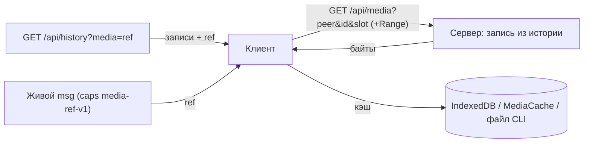

# История без вложений внутри: ссылка на медиа вместо data URL — спецификация

Статус: §1 принят владельцем 2026-11-08. Фаза 1: сервер (`fb9e8c0`), веб (1.137) и
классический транспорт терминала сделаны и проверены вживую; APK и ядро (`TAILCHAT_CORE=1`)
ещё нет — они по-прежнему получают inline-байты (записи worklog от 2026-11-08). Текст ниже —
исходное предложение.
Факты ниже прочитаны в рабочем дереве на основе `583dc57` (APK 188, веб 1.136) и один раз
измерены на изолированном локальном сервере с временными данными (§13.6). Каждое утверждение о
производстве помечено `[INFERENCE]`.

**Соглашения.** Короткие имена в ссылках `файл:строки` означают:

| В тексте | Файл |
|---|---|
| `server.js`, `accounts.js`, `hub.js`, `limits.js`, `journal.js`, `storage-crypto.js`, `migrate-storage.js`, `push.js`, `fcm.js`, `api.js`, `link.js` | `src/cloud/…` |
| `cli.js` | `src/cli.js` |
| `app.js`, `sw.js` | `web/cloud/…` |
| `CloudApi.kt`, `CloudSocket.kt`, `SyncEngine.kt`, `CloudController.kt`, `CloudModels.kt` | `android/app/src/main/java/net/tailchat/android/cloud/…` |
| `MediaCache.kt`, `ChatRepository.kt`, `Entities.kt`, `Daos.kt`, `TailchatDatabase.kt` | `android/app/src/main/java/net/tailchat/android/data/…` |
| `api.rs`, `frames.rs`, `engine/sync.rs`, `frames/inner.rs`, `frames/history.rs`, `frames/en.rs` | `crates/tailchat-core/src/…` |
| `schema.rs` | `crates/tailchat-store/src/schema.rs` |
| `cloud-server.test.js`, `cloud-sw.test.js` | `test/…` |
| `backlog.md`, `worklog.md` | `docs/…` |

Номера строк APK-файлов — рабочее дерево на момент написания. Над `CloudApi.kt`,
`CloudSocket.kt` и `SyncEngine.kt` одновременно работает параллельная задача `ApkHistoryFix`
(§13.3); если строки разъедутся, ориентир — имя функции. Строки коммита `583dc57` (сборка
188, с которой пришла жалоба) помечены явно.

## 1. Решения владельца

| Вопрос | Предложение | Почему |
|---|---|---|
| Ответ `/api/history` | В режиме `media=ref` каждая картинка/голосовое — описание `{mime,size,width,height}` / `{mime,size,duration}` вместо `dataUrl`; байты — отдельным запросом | Одна страница из 200 записей сейчас может весить 64 МиБ, и именно это ломает APK (§2) |
| Совместимость | Без явного `media=ref` ответ **побайтно прежний**; отдельный `media=inline` — тоже прежний | Установленные APK ≤188, старые бандлы веба, CLI и боты ждут `dataUrl` (`test/cloud-server.test.js:1061`) |
| Адрес вложения | `(peer, id, slot)`, `slot` — `image`/`voice` | Та же проверка видимости, что у истории (`accounts.js:2787-2794`), ноль нового состояния, тот же ключ идентичности во всех клиентах |
| Новый маршрут | `GET /tailchat/api/media?peer=&id=&slot=`, Bearer, `Range`+`ETag`, `Cache-Control: private, no-store` | §6 |
| Живой кадр `msg` | Для клиентов с `media-ref-v1` — ссылка; остальным — как сейчас, байты внутри кадра | Иначе 10-МиБ кадр ставит пинг и квитанции в очередь за собой и обрывает медленный сокет (§5.4) |
| Очередь офлайн | Хранимый формат очереди **не меняется**; ссылку собирает хаб на отправке для способного соединения | Откат сервера на старую сборку тогда безопасен; уменьшение файла — фаза 2 |
| Хранение на сервере | Фаза 1: байты остаются внутри записи `accounts.json`; вынос в блобы — фаза 2 (§8.3) | Отдельное решение, не нужно для исправления |
| Шифрование покоя | Транспорт — TLS; на диске сервера — прежний AEAD, на APK — прежний `MediaCache`; кэш браузера выключен | §8 |
| Push | Не меняется: текст и метка «📷 Photo»/«🎙 Voice message» | `hub.js:160-167`, `src/cloud/push.js:77`, `src/cloud/fcm.js:71-97` |
| Saved Messages | Тот же режим, свой лимит 5000 и бюджет 256 МиБ | `server.js:39,1153`, `accounts.js:2105`, `limits.js:17` |
| Ядро Rust | `Message` хранит ссылку; байты — у драйвера; в sans-IO контракте пара `Output::FetchMedia` / `Input::Media` | §10 |
| Отправка вложений | Не меняется: кадр `msg` несёт `dataUrl`, ≤10 МиБ (`hub.js:1670`) | Не в этой задаче; P2P-канал и `file-*` тоже не трогаем |

## 2. Задача

### 2.1 Что сообщено

Один человек на Android (APK 188) видит в беседе только утренние сообщения и ни одного
голосового, а веб-клиент показывает всё. Совпадающая по описанию жалоба уже записана без
локализации: `docs/backlog.md:5-15` (2026-10-28).

### 2.2 Что видно в коде (подтверждено чтением)

- **Потолок страницы.** `/api/history` по умолчанию отдаёт 200 записей, максимум 5000
  (`server.js:37-39,1378-1382`, `accounts.js:31`), а бюджет медиа беседы — 64 МиБ base64
  (`limits.js:7-11`). Бюджет вытесняет самое старое, но не ограничивает то, что осталось,
  поэтому одна страница несёт до 64 МиБ. Измерено: страница из 200 записей, у каждой картинка
  ~330 КиБ base64, — **63.7 МиБ**, выдача ~0.2 с, блокировка цикла событий сервера ~100 мс
  (§13.6).
- **Кадр живого сообщения.** `msg` уходит подписанному сокету целиком
  (`hub.js:1254-1309`), собственным другим сеансам — копией (`hub.js:1098-1103`), в очередь —
  тем же объектом (`hub.js:1417-1418`); сервер сериализует полезную нагрузку на каждое
  соединение (`server.js:425-435`).
- **APK со сборкой 188 (коммит `583dc57`) качает страницу целиком под 8 с.** `callTimeout(8,
  SECONDS)` на общем клиенте (`CloudController.kt:455-457`), `execute` читает всё тело
  `body.string()` и парсит его целиком (в `583dc57`: `CloudApi.kt:384-404`), страница — 200
  записей (`HISTORY_PAGE_DEFAULT` в `CloudApi.kt`, `HISTORY_PAGE` в `SyncEngine.kt`), причём до двух
  страниц параллельно (`HISTORY_CONCURRENCY` в `SyncEngine.kt`).
- **В рабочем дереве идёт параллельная правка (`ApkHistoryFix`) — смягчение, но не решение.**
  У истории свой клиент: `callTimeout(0)` и `readTimeout(30 s)`, тело читается не больше 40 МиБ
  (`historyClient`, `HISTORY_READ_TIMEOUT_SECONDS`, `HISTORY_MAX_BODY_CHARS` в `CloudApi.kt`); страница, которая не влезла или оборвалась, перепрашивается
  вдвое меньшим `limit` (до `HISTORY_MIN_PAGE`, не больше `MAX_PAGE_ATTEMPTS` раз) и ошибка
  теперь пишется в лог (`loadHistory`, `historyFailed`, `HISTORY_MIN_PAGE`, `MAX_PAGE_ATTEMPTS`
  в `SyncEngine.kt`). Текст перестаёт
  пропадать совсем, но цена страницы прежняя: те же десятки мегабайт скачиваются заново на
  каждую попытку, а 40 МиБ тела вместе с деревом JSON всё ещё целиком лежат в памяти
  [`INFERENCE`: на устройстве не измерялось]. Ошибка перестала быть немой только в логе —
  человеку она по-прежнему не видна, пока не сработает `permanent` в `historyFailed`.
- **Веб ждёт сколько нужно.** У веба нет ни дедлайна, ни тайм-аута на `request()`
  (`app.js:13231-13258`), поэтому он и показывает всё.
- **CLI тоже под 8 с.** `TIMEOUT_MS = 8000` и `AbortSignal.timeout` на каждый вызов
  (`api.js:6,36-41`). Проверено на Node 24: сигнал обрывает и **чтение тела**, ответ пришёл за
  27 мс, тело — отказ на 505 мс при лимите 500 мс. Ответ `null` даёт `TypeError` в
  `api.history` (`api.js:108-112`, `src/cli.js:5265-5277`), который ловится и печатается как
  «офлайн».
- **Второй дефект, объясняющий «ни одного голосового» — в рабочем дереве уже исправлен той же
  параллельной задачей.** Сервер хранит дробную длительность как есть (`accounts.js:319-324`),
  а APK читала её `intOrNull` и на дроби отбрасывала весь `voice` (в `583dc57`:
  `CloudApi.kt:485-489`, `CloudSocket.kt:888-893`). Веб длительность измеряет дробной
  (`app.js:5186-5204`), то есть голосовые, записанные из браузера, для APK превращались в
  сообщения без вложения. Сейчас оба места читают `doubleOrNull` (`toCloudVoice` в обоих файлах). Сервер обязан и дальше отдавать float — это контракт §5.1.

### 2.3 Что не подтверждено

- Гипотеза «страница перестала влезать в 8 с» на реальном разговоре владельца не проверена:
  нет замера размера его страницы. Команда для владельца — §13.7.
- После параллельного смягчения (§2.2) отказ на новом APK может уже не воспроизводиться «в
  лоб» — он станет «медленно и дорого» вместо «навсегда пусто»: страница перепрашивается
  меньшей, но те же десятки мегабайт всё равно скачиваются. Поэтому воспроизведение для этого
  документа — сборка 188 либо выключенное смягчение; иначе виден только счётчик байтов. [`INFERENCE`]
- Настоящее устройство/эмулятор с троттлингом не запускались; обрыв 8-секундного бюджета
  OkHttp на теле не измерялся, только выведен из `callTimeout` и размера тела.
- Продовый путь Caddy/Cloudflare не проверялся; пиковые таймауты Node (300 с) и ожидание
  заголовков Caddy по умолчанию [INFERENCE] больше реального времени скачивания.

## 3. Где сейчас выдаются записи с вложениями

| Путь | Что несёт | Код |
|---|---|---|
| `GET /api/history` | Полные записи, вложения — base64 внутри | `server.js:1134-1177`, `accounts.js:2773-2811` |
| Живой `msg`/`ai` | Тот же кадр целиком, с вложением | `hub.js:1254-1309,1852,1875` |
| Копия своим другим сеансам | Тот же кадр | `hub.js:1098-1103,1403` |
| Очередь офлайн → `subscribe` | Кадр, у старых — со срезанными вложениями (`mediaDropped`) | `accounts.js:1728-1741,1743-1760`, `hub.js:923-928` |
| Saved Messages | То же самое, копия себе | `hub.js:1254-1309`, `accounts.js:2105` |
| Список беседы / ростер | Только слово «image»/«voice», без байтов | `accounts.js:2836-2845` |
| Пуш | Только текст/метка, id, отправитель | `hub.js:1440-1449`, `fcm.js:91-97` |
| Лента `sync`/`sync-page` | Только `id/ts/from` | `accounts.js:2086-2088,2274-2293` |
| `message-event` (веб) | Только `del`/`edit`/`react`; вложений не несёт — `msg` им не рассылается | `hub.js:1199-1206,1915,1932,1949` |
| Ответы/пересылка | Снимок `replyTo` без байтов | `accounts.js:345-356` |

Вложения на сервере нормализуются в `{dataUrl,width,height}` / `{dataUrl,duration}`
(`accounts.js:306-327`), удаление для всех стирает их и ставит надгробие
(`accounts.js:443-448`), вытеснение по бюджету — `mediaDropped` (`accounts.js:1983-2023,2093-2113`).
Каждый коммит целиком уходит в журнал как NDJSON строка (`accounts.js:2156-2185`,
`journal.js:55,57-80`), файл — AEAD-конверт на имя файла (`storage-crypto.js:26-36`).

## 4. Решение: описание вместо байтов



Сервер остаётся единственным местом, где лежат байты; клиент получает описание и решает,
когда их скачать. Ни одна страница истории больше не зависит от размера вложений.

## 5. Контракт `/api/history` в режиме ссылок

### 5.1 Формат

```json
{ "id": "m-…", "from": "anna", "text": "", "ts": 1756900000000,
  "image": { "mime": "image/webp", "size": 262144, "width": 1280, "height": 960 } }
{ "id": "m-…", "from": "bob", "text": "привет", "ts": 1756900000123,
  "voice": { "mime": "audio/webm;codecs=opus", "size": 96512, "duration": 12.34 } }
```

Поля:

- `mime` — тип из исходного `data:` URL как есть (с параметрами), из уже проверенной грамматики
  `normalizeMedia` (`accounts.js:311,319`).
- `size` — **число байт после base64-декодирования**, а не символов. Именно его отдаёт
  `Content-Length`, и клиент сверяет его с полученным.
- `width`/`height` — целые 1…8192, как сейчас (`accounts.js:315-316`); `duration` — секунды,
  float 0…600 (`accounts.js:323`). Float — чтобы APK перестал терять дробные голосовые (§7.2).
- Поле `dataUrl` в режиме ссылок не выдаётся никогда; `dataUrl` и `size` вместе — ошибка
  клиента, а не вариант.
- Ссылка выдаётся, только если base64 раскодируется в непустые байты. Запись, которую
  `normalizeMedia` приняла, но чьи байты пусты, в режиме ссылок выходит без вложения: клиенту
  нечего скачивать, а `data:` с пустым payload уже не рисуется ни в одном клиенте.
- `mediaDropped: true` и надгробия (`deletedAt`) — без изменений.
- Записи **без `id`** (старые кадры без идентификатора, `hub.js:1228`) адресовать нечем:
  в режиме ссылок они выходят в прежней inline-форме. Так же выходят записи с `id` длиннее
  1024 байт (§6.2): сервер сегодня проверяет только непустоту, но маршрут медиа обязан назвать
  границу — иначе `id` из запроса стал бы неограниченным ключом. Счётчики обеих категорий — §13.7.

Почему адрес `(peer, id, slot)`, а не непрозрачный `mediaId` и не хеш содержимого:

- **Проверка доступа та же, что у истории**, потому что ищется та же запись той же беседы и
  применяются те же правила видимости (`accounts.js:2787-2794`).
- **Ноль нового состояния на сервере**: ни поля в записи, ни индекса, ни миграции
  `accounts.json`; старые и новые записи обслуживаются одинаково.
- **Тот же ключ идентичности, что у всех клиентов**: `(accountKey, peer, id)` в Room
  (`Entities.kt:212-215`), `message.id` + беседа в вебе и CLI. Клиент никогда не хранит
  чужих идентификаторов.
- **Не мешает будущему**: фаза 2 (блобы) или E2EE добавят свои адреса в новой ревизии
  протокола; здесь схема остаётся читаемой.

Цена: адрес детерминирован, но он всё равно не даёт доступа без токена и проверки дружбы;
коллизия id в одной беседе у двух отправителей (сервер такого не запрещает) отдаст первую
запись — это тот же самый id, который клиенты и так считают одной строкой, поэтому баг не
хуже существующего.

### 5.2 Параметр `media`

- Нет параметра — **inline**, ответ побайтно прежний (совместимость по умолчанию).
- `media=ref` — ссылки.
- `media=inline` — явно прежний ответ (нужно ботам и тестам после возможной смены умолчания).
- Любое другое значение — `400 bad_request`: опечатка не должна молча выдать не тот режим.
- Ответ в режиме ссылок дополнительно несёт `"media": "ref"` на верхнем уровне, чтобы клиент и
  тест видели, что сервер режим понял; старый сервер поля не пришлёт (он и параметр проигнорирует).
- `view=web`, который веб уже передаёт (`app.js:9108,9143,9192`), сервер не читает вовсе —
  он не годится как признак версии и остаётся мёртвым параметром (убрать — отдельным релизом).

### 5.3 Живой `msg` и `media-ref-v1`

- Сервер объявляет в `ready.caps` новую строку `media-ref-v1` (`hub.js:115-118`), клиент
  объявляет её же в `auth.caps` (`hub.js:1964-1966`).
- Для соединения с этой возможностью хаб подменяет вложения **ссылкой** в: живом кадре
  получателю, копии своим другим сеансам и сообщении из очереди при `subscribe`.
  `message-event` трогать не нужно — им ходят только `del`/`edit`/`react` (`hub.js:1915,1932,1949`).
  Для соединений без возможности — ничего не меняется.
- Подмена — **по соединению** (`send()` в `hub.js:432-441`), не по получателю: у одного
  аккаунта могут быть одновременно старый телефон и новый браузер.
- Входящие кадры, хранимые записи и очередь остаются inline; поэтому проверка повтора по тому
  же id продолжает сравнивать байты (`hub.js:173-185`, `accounts.js:2144-2149`), а пуши не
  меняются (`hub.js:160-167`).
- Клиент, объявивший `media-ref-v1`, **обязан** продолжать принимать inline: так приходят
  кадры со старого сервера, кадры P2P-канала и собственное эхо.

### 5.4 Почему для способных клиентов ссылка, а не байты и в живом кадре

Измерено на изолированном сервере (второй замер §13.6, ускоренное окно heartbeat): читатель на
медленном канале, перед пингом которого стоит 9-МиБ кадр, обрывается heartbeat-ом — пинг не может обогнать кадр в очереди отправки, а
pong клиента не может обогнать кадр в очереди приёма. Контрольный прогон без кадра живёт.
Продовый heartbeat — 12 с на тик, два тика до обрыва (`server.js:35,480-509`); значит кадр,
который не успевает за ~24 с (меньше ~3 Мбит/с на 10 МиБ), обрывает сокет вместе с
недоставленным кадром [`INFERENCE`: продовые тайминги, замер шёл на ускоренном окне].
Размер кадра загрузки об этом уже знает (`server.js:484-493`); скачивание — тот же риск, а
ссылка его убирает: страница и кадры маленькие, байты идут HTTP-ом с `Range` и повтором.

Цена решения — лишний round-trip на каждое живое вложение: сегодня оно приезжает в кадре
сразу. Поэтому ссылка несёт `width/height`/`duration`, и заполнитель нужного размера рисуется
до байтов, а скачивание ставится в очередь сразу по получении кадра, для открытой беседы —
первым. Для способного клиента это один HTTP-запрос, мультиплексированный на том же
соединении; для картинки в 200 КиБ на 10 Мбит/с — доли секунды [`INFERENCE`: на устройстве не
измерялось].

## 6. Новый маршрут `GET /tailchat/api/media`

```
GET /tailchat/api/media?peer=anna&id=m-0123…&slot=voice
Authorization: Bearer <token>
Range: bytes=0-1048575          (необязательно)
If-Range: "<etag>"              (необязательно)
```

Ответ: `200`/`206`/`416`, тело — исходные байты (не base64), `Content-Length` — ровно `size`.

### 6.1 Заголовки

| Заголовок | Значение | Почему |
|---|---|---|
| `Content-Type` | `mime` из записи, из белого списка `image/jpeg,png,gif,webp` и `audio/*` | уже проверено `normalizeMedia`; вне списка — не хранится |
| `Cache-Control` | `private, no-store` | расшифрованные байты не должны лечь на диск браузера (§8) и не должны кэшироваться Cloudflare [`INFERENCE`: прод за Cloudflare, `docs/worklog.md:6091`] |
| `ETag` | сильный, короткий хеш декодированных байтов, мемоизированный по записи | `If-Range` для докачки; `If-None-Match` отвечает `304` без тела. Хеш считается один раз на запись и живёт, пока запись в памяти |
| `Accept-Ranges` | `bytes` | докачка |
| `Content-Range` | на `206` — `bytes a-b/total`; на `416` — `bytes */total` | RFC 9110 |
| `Content-Security-Policy`, `X-Content-Type-Options`, `Referrer-Policy` | те же, что у `writeResponse` (`server.js:1568-1588`) | ответ не должен исполняться как документ |

`Range`: один диапазон `a-b`, `a-`, `-n` — `206`; конец за пределом `size` подрезается до
`size - 1`; несколько диапазонов — полный `200` (не собираем multipart без нужды);
неудовлетворимый (`a >= size`, `-0`) — `416` с `Content-Range: bytes */total`; `If-Range`
совпал с текущим `ETag` — диапазон, не совпал — полный `200`. Тело ответа никогда не больше
`size`; `Range` не может запросить больше, чем сервер и так отдаёт целиком. `HEAD` уже поддержан
маршрутной таблицей (`server.js:642`) и обязан отдавать те же заголовки без тела.

### 6.2 Отказы

| Код | Ошибка | Когда |
|---|---|---|
| `401` | `unknown_token` | нет/неизвестен Bearer (`authorize`, `server.js:1398-1401`) |
| `400` | `bad_request` | плохой `peer`, пустой `id`, `id` длиннее 1024 байт или с управляющими символами, `slot` вне `image`/`voice` |
| `403` | `not_friends` | не друг и не Saved (тот же порядок, что в `handleHistory`, `server.js:1145-1148`) |
| `404` | `not_found` | записи нет, вложение удалено «у себя» (`state.hidden`), беседа срезана удалением контакта (`purgeSeq`/`beforePurge`, `accounts.js:1593,856`) |
| `410` | `media_deleted` | запись — надгробие (`deletedAt`) |
| `410` | `media_evicted` | бюджет беседы/сохранённых снял вложение (`mediaDropped`) |
| `429` | `too_many_requests` | лимит одновременных выдач (§6.3) |
| `500` | `server_error` | прочее |

Блокировка (`hasBlocked`) историю не затрагивает (`hub.js:1644-1651`), поэтому и медиа не
трогает — паритет с `/api/history` явно записан в §15. Удалённый контакт: у второй стороны
записи остаются, но её `peers` не в ростере — `history` их не отдаёт, значит и медиа `404`.

Отдачу `410` вместо `204` выбираем, чтобы клиент отличил «удалено» от «ещё качаю»:
это одно и то же состояние, в котором веб уже рисует `mediaExpired` (`app.js:533,9968-9974`),
а APK в новой версии будет рисовать тот же текст (§7).

Найдено по чтению: `findHistoryMessage` ищет линейно по всей беседе
(`accounts.js:2028-2034`). Для страницы из 200 вложений это 200 проходов; в §9 добавлен
индекс `(conversation, id) → record` в памяти, без видимого контракта.

### 6.3 Пределы

- Размер одного ответа ≤ 7 864 320 байт (base64-кодированное поле ≤ `CLOUD_MEDIA_MAX_CHARS`
  = 10 МиБ символов, `limits.js:4`; точная граница считается по факту декодирования).
- Одновременных выдач: 8 на аккаунт, 32 на процесс; сверх — `429` сразу, без очереди (HTTP-клиент
  и так ограничивает себя сильнее, §7).
- Никакого нового лимита запросов по IP нет: он уже есть на входе
  (`createAttemptLimiter`, `server.js:1464-1532`) и не про авторизованные выдачи.

### 6.4 Совместимость и матрица

| Сервер → / клиент ↓ | старый (без `media=ref`, без `media-ref-v1`) | новый |
|---|---|---|
| APK ≤188 | inline, как сейчас | inline: параметра не шлёт, возможностей не объявляет — ответ побайтно прежний |
| Веб 1.136 (старый бандл) | inline | inline, пока бандл не обновится |
| CLI/боты старой версии | inline | inline |
| Новый клиент (отправляет `media=ref`) | inline (сервер параметр игнорирует) — новый клиент **обязан** его принимать | ref + `/api/media` |
| Новый клиент ↔ старый сервер в живом кадре | inline | — |

Обратный откат тоже безопасен: старый сервер просто игнорирует параметр и строку
возможности, новый клиент рисует inline.

### 6.5 Миграция и выкатка

Данных мигрировать не нужно: в `accounts.json` ничего не меняется, у веба постоянного состояния
нет, кэш CLI сам перезапишется при следующем открытии беседы, а APK получает только свою
миграцию Room 12→13 (вперёд, без откатов, §7.2). Поэтому выкатка — это порядок шагов:

1. **Сервер.** Маршрут `GET /api/media`, параметр `media=ref`/`media=inline`, строка
   `media-ref-v1` в `ready.caps`, подмена в `send()`. Умолчание — inline: установленные APK ≤188,
   старые бандлы веба, CLI и боты не замечают ничего. Проверки — §13.1.
2. **Веб.** Просит `media=ref`, объявляет возможность, качает по ссылке. Релиз по AGENTS §7 —
   четыре cache-buster'а в одном коммите. Старый бандл в чужом кэше продолжает получать inline.
3. **CLI и боты.** CLI просит ссылки и качает их своим путём; бот оставляет `media=inline`
   явно, чтобы переставший работать по умолчанию сервер его не сломал. Бот — отдельный релиз,
   не связанный с вебом.
4. **APK.** Ссылки, `MediaFetcher`, колонки v13. По AGENTS §8 выходит вместе с сервером, и
   только этот релиз чинит людей со сборкой 188.
5. **Наблюдение.** Строка `/api/history` считает `media=ref` против `media=inline`; строка
   медиа считает `410 media_evicted` (сколько вложений не успели скачать) и байты. Это и есть
   ответ на «можно ли менять умолчание».
6. **Cutover — только по решению владельца**, не автоматически. Условие, которое надо
   выполнить: за 30 дней нет ни одного человека-клиента без `media=ref` (боты и CLI обновлены
   и шлют `media=inline` явно), а счётчик `410 media_evicted` не растёт. Тогда умолчание
   переключается одной константой; откат — та же константа обратно, старые клиенты не задеты.
7. **Удаление inline-формы** — последним и только когда не осталось установленных APK ≤188:
   `media=inline` начинает обслуживаться преобразованием из блоба (фаза 2) и остаётся для ботов.

Совместимость в обе стороны проверяется матрицей §6.4: новый клиент со старым сервером
получает inline и обязан его рисовать; старый клиент с новым сервером получает ровно тот же
ответ, что и раньше.

## 7. Что должна сделать каждая поверхность

### 7.1 Сервер и веб

**Сервер** (файлы: `src/cloud/server.js`, `accounts.js`, `hub.js`, `limits.js`):

- `ROUTE_METHODS` и `handleRequest` — строка маршрута медиа (`server.js:121-171,675-721`);
  он попадает ровно в `MEDIA`-ветку, не в последний `handleMe`.
- `handleHistory`: разбор `media`, `store.history(..., { mediaMode })`, ответ `media`.
- Новый `handleMedia`: авторизация, проверка дружбы, разбор `Range`, `ETag`, `410`-матрица,
  лимит одновременных выдач. Пишет одну строку замера (`docs/cloud-logs.md`-стиль,
  `hub.js:1049-1052`): `Tailchat cloud: media login=… peer=… status=… bytes=… ms=…` —
  без `id` и без содержимого.
- `accounts.js`: `mediaRef(record, slot)` → `{mime,size,width|height|duration}` и
  `findVisibleRecord(owner, peer, id)` с общей проверкой видимости; `history()` получает
  `mediaMode` и на копии записи (не на хранимой, `accounts.js:2805-2810`) подменяет вложение.
- `hub.js`: `media-ref-v1` в `SERVER_CAPS`; в `send()` — по соединению заменить вложения
  ссылкой для исходящих `msg`/`ai`; в `subscribe` — то же для кадров из очереди.
- `limits.js`: `MEDIA_INFLIGHT_PER_ACCOUNT`, `MEDIA_INFLIGHT_TOTAL`; бюджет очереди
  (`CLOUD_QUEUE_MEDIA_BUDGET_CHARS`) в фазе 1 остаётся.

**Веб** (`web/cloud/app.js`):

- Все три места истории просят `media=ref` (`app.js:9108,9142-9145,9192`) и объявляют
  `media-ref-v1` в `auth` (`app.js:11848-11852`).
- `image`/`voice`-состояние в строке: «нет ссылки» → «качаю» → «есть blob:» → «не вышло».
  Рисовать размер из `width/height` до байтов, как это уже делает `buildImagePreview`
  (`app.js:4858-4905`).
- Новый помощник `fetchMedia(peer, id, slot)`: `fetch` с Bearer, дедупликация по ключу,
  ограничение 4 одновременных, сторож 30 с без байтов, `AbortController` на смену беседы,
  `blob:` через `URL.createObjectURL`, освобождение при вытеснении беседы из `threads`
  (`app.js:2133`) и при `tombstoneMessage`.
- Голосовое: `buildVoicePlayer` и `decodeVoicePeaks` берут готовый blob URL; до байтов — карточка
  с длительностью и полосками-заглушкой (`app.js:5777-5907`).
- Пересылка: перед кадром дождаться blob и отдать `dataUrl` (`app.js:11246-11281`).
- `messageAttachments` дополняется ссылкой, а не байтами (`app.js:2134-2141,5725,10364`).
- `sw.js` не меняется: `fetch`-обработчик уже пропускает всё под `/api/`
  (`sw.js:51-54`), но новый тест это фиксирует (§13).
- Релиз веба — по §7 AGENTS: `?v=` в `index.html`, `SHELL_ASSETS`, `CACHE_NAME` и литерал
  в `test/cloud-sw.test.js`; это делает владелец при выкатке.

### 7.2 APK (`android/app/src/main/java/net/tailchat/android/…`)

- `CloudApi.kt`: `history()` добавляет `media=ref` и читает `{mime,size,width,height}` /
  `{mime,size,duration}` **без** `dataUrl` (`history()`, `toCloudImage`, `toCloudVoice`). Дробная
  длительность там уже читается `doubleOrNull` — параллельная правка §2.2.
- `CloudSocket.kt`: в `auth.caps` — `media-ref-v1` (`CLIENT_CAPS` и `CAP_*` в `CloudSocket.kt`);
  `toCloudImage`/`toCloudVoice` принимают и ссылку, и inline.
- `CloudModels.kt`: у `CloudImage`/`CloudVoice` `dataUrl` становится nullable, добавляются
  `mime`/`size` и состояние (см. ниже) — старые читатели не ломаются, если поле оставить.
- `SyncEngine.kt`: `loadHistory` не меняет цикл, но перестаёт получать байты; хуки «новое
  сообщение → поставить в очередь скачивания» — в `Observer.onMessage` и после
  `applyHistoryPage` в `loadHistory`. Половина страницы по `too_large`/`transfer_failed`
  (`loadHistory`) **остаётся** как страховка: сервер
  вправе быть старым, а ошибка «сервер отдал больше, чем назвал» всё равно требует повтора
  меньшим запросом.
- `ChatRepository`/Room: новые колонки `imageMime`,`imageSize`,`imageState` / `voice…`
  (схема v13, `MIGRATION_12_13`, экспорт `13.json` — `TailchatDatabase.kt:36-38,78-106`).
  `mediaTag` и «есть вложение» смотрят на `size`/`mime`, а не на непустой `dataUrl`
  (`ChatRepository.kt:890-894`). `withCachedMedia` (`ChatRepository.kt:915-922`) не трогает
  ссылку; `Daos.merge` (`Daos.kt:636-663`) при ссылке сохраняет локальный медиа-указатель.
- Новый `MediaFetcher` (в `cloud/`): очередь по `(peer,id,slot)`, 3 одновременных, `Range`-докачка
  внутри одной попытки (частичные байты — только в памяти, диск не пишется до полного файла),
  сверка `size`, повторы 5 с → ×2 → 5 мин, `410`/`404` — окончательно; запись через
  `MediaCache.store` под ключом `peer|id|slot`.
- «Качаю»/«не вышло, нажмите» — те же строки во всех трёх клиентах (§11 AGENTS); для «не вышло»
  нужны новые строки в `values/strings.xml`, `values-ru`, `values-fr`.
- `resolveMedia` (`CloudController.kt:305-314`) должен уметь «ещё нет» отдельно от «файла нет»;
  пересылка не должна отправлять сообщение без вложения молча (`CloudController.kt:1206-1223`).

**Найдено попутно:** ключ `MediaCache` — `hash(accountKey)/hash(id)-slot`, без `peer`
(`MediaCache.kt:92`). Одинаковый id в двух беседах одного аккаунта попадёт в один файл. Случайно
это почти невозможно, но новый код адресует по `peer` — ключ стоит дополнить.

### 7.3 CLI (`src/cli.js`, `src/cloud/api.js`)

- `api.history` получает `{media: 'ref'}` (`api.js:108-112`); `cloud.api.history` в
  `src/cli.js:5265` остаётся с `limit=200`.
- `renderCloudMessages` (`src/cli.js:5191-5244`) вместо `cm.image?.dataUrl` смотрит на ссылку и
  ставит задачу `fetchMedia`, которая уже есть — `queueInlineMedia` (`src/cli.js:4307-4327`),
  по одной за оборот цикла; байты пишутся в `filesDir` тем же `saveInlineAttachment`
  (`src/cli.js:4242-4267`).
- Кэш `cloud-cache/<peer>.json` (`src/cli.js:922-926,944-1098`) хранит ссылки — файл
  перестаёт быть «мегабайтами» (`src/cli.js:930-933`).
- Живой кадр: объявить `media-ref-v1` (`src/cloud/link.js:642-645`) и принимать ссылку в
  `src/cli.js:7478`/`7501`, скачивая её тем же путём.
- Дедлайн: вместо жёстких 8 с на всё — сторож без прогресса (30 с без байтов), потому что
  докачка 7.5 МиБ на мобильном канале может длиться минуту. Тайм-аут `api.js` остаётся для
  коротких вызовов.
- Исправить `null`-ответ истории: `CloudApiError('unreachable')` вместо `TypeError`.

### 7.4 Боты и ядро Rust

- `bots/client.mjs:415-426` и `bots/reminder.mjs:919-945` по умолчанию получают inline и **не
  меняются**. В `bots/reminder.mjs` уже есть `mediaDropped`-ветка (`bots/reminder.mjs:937-939`).
- После возможной смены умолчания (§6.5) бот обязан просить `media=inline`, иначе перестанет
  слать картинки. Отдельная опция «переслать по id без копирования байтов» — фаза 2.
- Ядро — §10.

### 7.5 Что намеренно не трогаем (AGENTS §13)

- P2P-канал (WebRTC data channel) и `file-offer/file-chunk/file-done` — не записи истории,
  вложений `image`/`voice` не несут (`app.js:5102-5173`, `hub.js:16-20`).
- Отправку inline-кадров и лимиты `CLOUD_MEDIA_MAX_CHARS` (`hub.js:1670`, `limits.js:4`).
- Пуши, ленты `sync`, ростер, `lastMessage` — байтов там и нет.
- Ответы (`replyTo`) и `forwardedFrom` — снимок без байтов (`accounts.js:345-369`).
- Лестницу меток AGENTS §12: метки привязаны к строке, а не к байтам; «✓✓» не меняется от того,
  скачано ли вложение (§8.4 и вопрос 4 §14).
- Формат PNG аннотаций и звуковые эффекты — нет связи.

## 8. Хранилище, шифрование и сохранность

### 8.1 Сейчас

- Сервер: `accounts.json` и `accounts.journal` — AEAD-конверты на каждый файл/строку
  (`storage-crypto.js:10-87`, `journal.js:55`); медиа внутри, то есть зашифровано вместе с текстом.
- APK: медиа вынуто из Room в `media-cache-encrypted/` и шифруется ключом устройства
  (`MediaCache.kt:7-35`, `EncryptedFile`).
- CLI: `cloud-cache/*.json` пишутся шифрованным `secureStore` (`src/cli.js:978-980`,
  каталог — `src/secure-store.js:248-250`).
- Веб: своего хранилища нет; токен живёт в `sessionStorage` (`app.js:13584-13613`), медиа
  сейчас вообще не касается диска (история `no-store`, `server.js:1568`).

### 8.2 Фаза 1

Ничего не перемещается: ссылка указывает на ту же запись, что и раньше. Требования:

- Байты отдаются только по TLS, с `private, no-store`; в лог не попадают ни id сообщения, ни
  содержимое — только `peer`/`status`/размер, как `Tailchat cloud: read …` (`hub.js:1089-1092`).
- Клиентские копии остаются в уже зашифрованных хранилищах (APK, CLI).
- Веб: расшифрованные байты не должны осесть в дисковом кэше браузера (`no-store`, вопрос 3 §14).

### 8.3 Фаза 2 (не в этой задаче)

Отдельное решение: вынести вложения из `accounts.json` в блобы на диске. Инварианты, которые
такая фаза обязана сохранить:

- каждый блоб — свой AEAD-конверт с именем файла в AAD (`storage-crypto.js:28,35`); `media/`
  добавить в `DATA_FILES` (`storage-crypto.js:7`) и в офлайн-миграцию (`migrate-storage.js:8`);
- файл сбрасывается на диск (`fsync`) и переименовывается атомарно **до** записи о нём —
  тот же порядок, что у `journal.js`: сначала блоб, потом строка; удаление — сначала строка,
  потом файл; крэш в промежутке оставляет сироту-файл, но никогда — строку без байтов;
- ссылка `(peer,id,slot)` остаётся адресом; меняется только способ хранения.

Зачем это вообще нужно, хотя эта задача закрывается без него: журнал — NDJSON, строка с
10-МиБ вложением после AEAD и base64 — это ~13 МиБ на один коммит (`accounts.js:2178`,
`journal.js:55`), и снапшот переписывает весь файл (`accounts.js:968-980`).

### 8.4 Байты — не квитанция

Существующая политика «сообщение доставлено — значит, устройство получило строку» не меняется:
`ack` идёт после того, как строка в Persist (`docs/specs/2026-11-01-rust-core.md`), а не после
скачивания вложения. Иначе «✓✓» зависел бы от того, долистал ли человек до картинки.

Следствие, которое надо назвать: бюджет 64 МиБ может снять вложение раньше, чем чужое
устройство его скачает, и тогда оно получит `410` до первой загрузки. Сегодняшний код от этого
защищён тем, что байты приезжают в кадре. Чтобы окно не расширилось, клиенты качают новое
**сразу при поступлении**, а не при прокрутке (вопрос 4 §14). Когда девайс всё же хранит копию,
а сервер уже вытеснил вложение, потеря локальной копии — потеря единственного экземпляра:
автоматическая очистка локального медиа-кэша не должна срабатывать на такие записи.

## 9. Сервер: хранение и видимость (сводка по файлам)

| Файл | Что | Строки |
|---|---|---|
| `src/cloud/server.js` | маршрут, `handleHistory` (`media`), `handleMedia`, `Range`/`ETag`, ошибки, лог | `121-171,699-701,1134-1177,1378-1382,1568-1588` |
| `src/cloud/accounts.js` | `mediaRef`, `findVisibleRecord`, `mediaMode` в `history()` | `306-327,2773-2811,2028-2034` |
| `src/cloud/hub.js` | `media-ref-v1` в `SERVER_CAPS`, подмена в `send()`, кадры очереди при `subscribe` | `115-118,432-441,923-928` |
| `src/cloud/limits.js` | лимиты одновременных выдач | `4,7-24` |
| `docs/cloud-logs.md` | строка замера медиа, по образцу §2 док-та | — |

## 10. Ядро Rust (`crates/tailchat-core`)

Ядро не подключено ни к одному клиенту (`docs/specs/2026-11-01-rust-core.md:42-44`), поэтому
ломка контракта здесь свободна — но ссылаться на `StoreOp` оно обязано так же, как эталон
`tests/common/mod.rs` (`docs/specs/2026-11-01-rust-core.md:45-48`): меняя `StoreOp`, менять оба,
иначе `conformance.rs` покажет расхождение.

### 10.1 Кодек

- `frames/inner.rs`: `Image {data_url,width,height}` (`inner.rs:77-89`) и
  `Voice {data_url,duration}` (`inner.rs:91-100`) получают форму ссылки, как в §5.1
  (`mime`, `size`, `width`/`height`/`duration`), и остаются терпимыми через `de_media`
  (`inner.rs:356-359`).
- `frames/history.rs`: `HistoryRequest::path()` добавляет `&media=ref` (`history.rs:35-51`),
  `HistoryRecord` читает ссылку (`history.rs:102-107`).
- `frames/en.rs`: `CAPS` пополняется `media-ref-v1` (`en.rs:27`).
- `MAX_INBOUND` (40 МиБ, `frames.rs:70-75`) сохраняется: страница ссылок далеко ниже, а
  слишком большая по-прежнему означает «та же позиция, половина страницы»
  (`engine/sync.rs:620-629`).

### 10.2 Sans-IO контракт

```rust
/// GET /api/media?peer&id&slot — с токеном аккаунта.
pub struct MediaRequest {
    pub serial: u64,
    pub peer: Login,
    pub id: MessageId,
    pub slot: MediaSlot,      // Image | Voice
    pub mime: String,         // из ссылки: драйвер ставит его в Content-Type
    pub size: u64,            // из ссылки: больше этого драйвер не читает
}

pub enum Output {
    // … Send / Persist / Event / Fetch …
    /// GET /api/media; ответ — ровно один `Input::Media` или `Input::MediaFailed`.
    FetchMedia(MediaRequest),
}

pub enum Input {
    // …
    /// Байты 200/206 уже лежат в хранилище драйвера под ключом запроса.
    Media { request: MediaRequest },
    MediaFailed { request: MediaRequest, error: MediaError },
}

pub enum MediaError { Network, Status(u16), TooLarge, SizeMismatch }

pub enum Action {
    // …
    /// UI просит байты (открыли беседу, нажали «повторить», начали играть).
    FetchMedia { peer: Login, id: MessageId, slot: MediaSlot },
}
```

`Action::Retry` остаётся тем, чем был — повтором исходящего сообщения; смешивать его с медиа
нельзя, иначе «повторить сообщение» и «докачать картинку» станут одной кнопкой без общего смысла.

Правила, те же, что у истории (`api.rs:50-63,78-90,124-138`):

- Ответ приходит ровно один раз на запрос, в том числе после обрыва; `serial` сверяется.
- Ядро ничего не держит в памяти: тело в ядро не попадает, только факт записи байтов.
- `410` → вложения больше не будет (`MediaState::Gone`, событие в UI); `404`/`403` →
  окончательно для этой ссылки; `401` → пауза до нового `ready`; `5xx`/сеть → пауза 5 с с
  удвоением до 5 мин на это вложение; `SizeMismatch`/`TooLarge` — окончательно до новой ссылки.
- Порядок «Persist до Send» (`api.rs:129-132`) распространяется и на медиа: `FetchMedia` уходит
  только для ссылки, уже лежащей на диске. На `Input::Media` ядро отвечает
  `StoreOp::PutMediaHeld { peer, id, slot, size }` — новой строкой в том же `StoreOp`, что и
  остальные; отдельной таблицы и отдельного `Snapshot`-поля не нужно, потому что «качать» —
  это `MediaState::Remote` в самой строке `Message`.
- Долг «качать» хранится состоянием строки (`api.rs:219-251`): `Message` заменяет
  `image`/`voice` на описание §5.1 и добавляет `media: MediaState` (`Remote`/`Held`/`Gone`).
- Скачивание вложения **не** задерживает `ack` (тот же принцип §8.4) и не блокирует
  `MessageStored`: строка приходит в UI сразу, с состоянием `Remote`.
- Триггеры: живой `msg` и найденная в долге из ленты запись — `FetchMedia` сразу, до того как
  UI что-то попросит; полный обход после `reset` — только по `Action::FetchMedia` (лениво).
- Пересылка: байты нужны, а в контракте `Outgoing` их нет (`api.rs:13-24`), и отправка вложений
  — не эта задача. Поэтому `MediaState::Held` — единственное предусловие будущей пересылки;
  `Gone` пересылать нельзя, и ядро обязано сказать об этом событием, а не отправить пустое
  сообщение.

### 10.3 Хранилище

- `platform.rs`: рядом со `Storage` — `MediaStore { put(key, bytes) -> Result<(), E>; get; remove }`.
  Ключ — тот же `(peer, id, slot)`.
- `tailchat-store/src/schema.rs`: `image_url/voice_url` (`schema.rs:51,54`) → `image_mime,
  image_size, image_width, image_height, image_state` и `voice_mime, voice_size,
  voice_duration, voice_state`; `voice_duration` уже `REAL` (`schema.rs:55`).
  Обнуление столбцов при надгробии (`Daos.kt:556-558` в APK; в сторе — `apply.rs`) стирает и
  состояние.
- Миграции нет, пока `user_version = 1` (`schema.rs:8,90`) никем не открыт, кроме тестов:
  правится схема 1. Открытый вопрос владельцу — вопрос 5 §14.
- Байты — рядом с базой, каждый в своём AEAD-конверте с тем же `Key` (`tailchat-store/src/lib.rs`).

## 11. Как это снимает отказ APK

Цепочка устраняется по звеньям:

1. **Размер страницы** перестаёт зависеть от вложений: 200 записей со ссылками — единицы
   килобайт (пересчёт того же набора в формат §5.1: 25.4 МиБ inline → 23.1 КиБ). `callTimeout` 8 с
   перестаёт быть размером страницы.
2. **Скачивание** — по вложению, ≤7.5 МиБ каждое, с `Range` и собственным дедлайном; одному
   медленному вложению больше не подчинён текст беседы.
3. **Ошибка перестаёт быть немой**: у каждого вложения своё состояние и свои повторы, а не
   один `runCatching` на всю страницу (в `583dc57`: `SyncEngine.kt:1861-1863`).
4. **Голосовые с дробной длительностью** (второй, независимый дефект §2.2) читаются
   `doubleOrNull`; веб-запись перестаёт теряться. Это уже сделано параллельной задачей,
   контракт §5.1 закрепляет float на сервере.
5. **OOM**-окно сужается: страница больше не несёт 64 МиБ строки + дерева + копий до
   двух страниц сразу (`HISTORY_CONCURRENCY` × 200 записей; в `583dc57` — `CloudApi.kt:384-404`).

Как это соотносится с параллельным смягчением (`ApkHistoryFix`, §2.2): оно уменьшает `limit` и
даёт странице больше времени, но каждая попытка всё равно тянет до 40 МиБ и держит их в памяти,
а на мобильном трафике повтор с нуля стоит дорого. Ссылки делают страницу маленькой по
построению — смягчение после них остаётся полезной страховкой для старого сервера, а не
основным механизмом.

Чего это не делает: не чинит уже установленный APK 188 — сервер не может отдать ему меньше без
потери сообщений, потому что клиент сохраняет ответ полной копией и считает неполную страницу
началом истории (§12). Исправление для людей — новый APK, и по §8 AGENTS сервер и Android
выходят вместе.

## 12. Отвергнутые варианты

| Вариант | Почему нет |
|---|---|
| **Сменить умолчание сразу**: все ответы — ссылки | Обслуживаемые APK ≤188, старые бандлы, CLI и боты рисуют по `dataUrl`; они бы разом перестали показывать вложения |
| **Признак версии в `view=web`** | Сервер его не читает вовсе; угадывать версию по уже отправляемому мусору — скрытая связь |
| **Серверная обрезка старых страниц для старых клиентов** | Две поломки сразу: короткая страница читается как начало истории (`reachedBeginning` в `loadHistory`, `app.js:9151-9157`) → долг докачки списывается; а `merge` заменяет строку целиком (`Daos.kt:646-660`) → пропавшие вложения стирают уже скачанные локальные копии |
| **gzip на историю** | Медиа уже сжаты: base64 от 7.5 МиБ случайных байт жмётся 10.00 → 7.53 МиБ, выигрыш 25 % — не решение |
| **Уменьшить бюджет беседы** (аварийный рычаг без релиза) | Вытесняет у всех уже сохранившееся, необратимо, и всё равно не делает худшую страницу меньше двух последних вложений |
| **Непрозрачный `mediaId` или хеш содержимого в адресе** | Нужны новое поле в записи, индекс и миграция; сегодня ничего не дают, кроме косметики. Хеш можно добавить позже отдельным полем |
| **Все кадры оставить inline, только история — ссылки** | 10-МиБ кадр в живом канале ставит пинг/квитанции в очередь и обрывает медленный сокет (§5.4); при этом подмена на сервере дешева |
| **Очередь тоже перевести на ссылки сразу** | Откат сервера на старую сборку тогда сломает доставку старым клиентам. Ссылка в фазе 1 собирается на отправке; хранимый формат не трогаем |
| **Подписанные URL или ``** | Токен в URL утекает в логи прокси и `Referer`; сессия веба в `sessionStorage` — `Referer` уже `no-referrer`, но лог остаётся |
| **Ответ `204` на вытесненное вложение** | Не отличить от «ещё качаю»; клиент зациклится. `410` — одно окончательное состояние |
| **Кэшировать медиа на диске браузера** (`private, max-age`) | Расшифрованная копия на диске — вопрос владельцу (вопрос 3 §14); по умолчанию повторяем сегодняшнее поведение |

## 13. Проверка (план)

Ничего из §13.1–13.5 и §13.7 ещё не запускалось — это план, а не отчёт. Единственный
выполненный замер — §13.6; он снимает цену сегодняшней выдачи, а не работу новой схемы.

### 13.1 Сервер (node --test на изолированном сервере, временные данные)

- Существующие `test/cloud-server.test.js` (в том числе `history` с `voice` побайтно,
  `cloud-server.test.js:1061`), `cloud-accounts`, `cloud-hub`, `cloud-encryption`, `cloud-link`
  — **без правок** зелёные: умолчание не менялось.
- Новый `test/cloud-media-refs.test.js`:
  - `media=ref` убирает `dataUrl`, добавляет `{mime,size,width,height}`/`{mime,size,duration}`,
    `size` равен `Content-Length` из `/api/media`;
  - `media=inline`, отсутствие параметра и мусорное значение (400);
  - `GET /api/media`: байты побайтно, `Content-Type`, `Cache-Control: private, no-store`, `ETag`;
  - `Range`: `0-99` → 206 и точные байты; `-100`; неудовлетворимый → 416; два диапазона → 200;
    `If-Range` совпавший/несовпавший;
  - отказы: 401 без токена (маршрут добавляется в список `cloud-server.test.js:307`), 403 не-другу,
    404 чужой/скрытый/срезанный, 410 надгробие, 410 `mediaDropped`;
  - Saved Messages свои и чужие;
  - лимит одновременных выдач — 429;
  - лог-строка медиа без id и без содержимого.
- Живой кадр и очередь: новое соединение с `media-ref-v1` получает ссылку, без неё — inline;
  два соединения одного аккаунта получают разное в одном и том же моменте; кадр из очереди
  после `subscribe` — ссылка для способного, inline для старого.
- `test/cloud-sw.test.js`: `/tailchat/api/media` не перехватывается SW.
- Контроль: те же тесты на старом коде падают там, где ожидается.

### 13.2 Веб (изолированный сервер + настоящий браузер)

- Открыть беседу с 200 записями медиа: сначала строка с размером-заполнителем, затем картинка.
- Голосовое: карточка с длительностью, скачивание при первом воспроизведении, играет.
- Пересылка скачанного и ещё не скачанного — оба случая дают вложение.
- Обрыв сети во время загрузки: карточка «не вышло» → повтор.
- `410` (вложение вытеснено на сервере под тестом) → `mediaExpired`.
- Переключение беседы во время загрузки: запрос отменён, чужие строки не получают картинку.
- Память: уйти и вернуться 10 раз — `blob:`-URL освобождены, вкладка не растёт.

### 13.3 APK (эмулятор `tailchat34`, изолированный сервер)

- **База.** Сборка 188 (коммит `583dc57`) на троттлинге ~1 Мбит/с и беседе из 200 записей с
  вложениями: страница 63 МиБ не влезает в 8 с — проверить, что видно (утренние сообщения,
  пропавшие голосовые / пустая история) и что в логах нет ни строки об ошибке.
- **Параллельное смягчение** (ветка `ApkHistoryFix`): тот же набор должен дать текст через
  несколько страниц вдвое меньшего размера и полный счётчик скачанных байтов (серверный лог
  `bytes=` на `/api/history`), чтобы §11 имел численное сравнение «до/после ссылок».
- **Новый APK (ссылки):** страница приходит одна, все 200 строк, картинки дозагружаются по
  видимости, голосовое играет; суммарный трафик меньше, чем у смягчения, на том же наборе.
- Обрыв сети на середине скачивания вложения → в сети снова: докачка, а не с нуля.
- Удаление «для всех» на сервере → строка становится надгробием, файл медиа-кэша удалён.
- Вытеснение по бюджету (серверная настройка теста) → тот же текст, что в вебе.
- Миграция Room 12→13 (`TailchatDatabaseMigrationTest`): открыть базу v12 с медиа, проверить,
  что кэш на месте и строки читаются.
- Дробная длительность (`duration: 12.34` из веба) — видно и играет; отдельно прогнать тест,
  добавленный параллельной задачей, чтобы правка не разошлась с этим контрактом.
- Saved Messages: свои вложения качаются, чистка кэша их не ломает (сервер хранит 256 МиБ).

### 13.4 CLI (изолированный сервер, временный `stateDir`)

- `/open` беседы с 200 записями: текст сразу, вложения по очереди, `/files` и `/open N` работают.
- `cloud-cache/<peer>.json` — килобайты, а не мегабайты; повторный запуск не теряет вложения.
- Живое сообщение со ссылкой: скачивается и показывается карточкой.
- 8-секундный дедлайн на медленном канале больше не рубит страницу.

### 13.5 Ядро (cargo)

- `cargo build`, `cargo test --workspace`, `clippy -D warnings`, `fmt --check`, `rustdoc`.
- `tailchat-store/tests/conformance.rs`: медиа-поля `Message` переживают каждую пачку и
  переоткрытие — без расхождения с `MemStore`.
- Новый сценарий в `tests/sync.rs`: живое сообщение со ссылкой → `FetchMedia` → `Input::Media`
  → `MessageStored` с `MediaState::Held`; `410` → `Gone`; обрыв в момент запроса → ответ ровно
  один раз, второй ответ игнорируется по `serial`.

### 13.6 Замеры, на которых стоят числа (изолированный сервер, не production)

Одноразовый скрипт вне репозитория, временные данные и ключ:

```js
import fs from 'node:fs'; import http from 'node:http'; import os from 'node:os';
import path from 'node:path'; import { randomBytes } from 'node:crypto'; import { performance } from 'node:perf_hooks';
const root = process.env.TAILCHAT_ROOT ?? process.cwd();
const { createAccountStore } = await import(`${root}/src/cloud/accounts.js`);
const { createCloudService } = await import(`${root}/src/cloud/server.js`);
const tmp = fs.mkdtempSync(path.join(os.tmpdir(), 'tc-probe-')); const keyFile = `${tmp}.key`;
fs.writeFileSync(keyFile, randomBytes(32).toString('hex'), { mode: 0o600 });
const store = createAccountStore({ dir: tmp, keyFile, initialize: true });
const service = createCloudService({ host: '127.0.0.1', port: 0, dataDir: tmp, webRoot: tmp, store, trustProxy: false, aiBridge: null, pushSender: null, fcmSender: null });
const { port } = await service.listen();
const call = (method, url, token, body) => new Promise((resolve, reject) => {
  const payload = body ? JSON.stringify(body) : null;
  const headers = { ...(token && { Authorization: `Bearer ${token}` }), ...(payload && { 'Content-Type': 'application/json' }) };
  const req = http.request({ host: '127.0.0.1', port, method, path: url, headers, agent: false }, (res) => {
    const parts = []; res.on('data', (c) => parts.push(c)); res.on('end', () => resolve(Buffer.concat(parts)));
  });
  req.on('error', reject); req.end(payload);
});
const token = async (login) => JSON.parse(await call('POST', '/tailchat/api/register', null, { login, password: 'correct horse', name: login })).token;
const anna = await token('anna'); const boris = await token('boris');
const invite = JSON.parse(await call('POST', '/tailchat/api/invite', anna)).invite;
await call('POST', '/tailchat/api/invite/accept', boris, { invite });
const image = `data:image/jpeg;base64,${Buffer.alloc(247 * 1024, 7).toString('base64')}`; // ~330 КиБ
for (let n = 1; n <= 200; n += 1) store.recordHistory('anna', 'boris', { id: `m-${n}`, from: 'boris', text: '', ts: 1_000_000 + n, image: { dataUrl: image, width: 1280, height: 960 } });
let stall = 0; let last = performance.now(); const timer = setInterval(() => { const now = performance.now(); stall = Math.max(stall, now - last - 10); last = now; }, 10);
const t0 = performance.now();
const body = await call('GET', `/tailchat/api/history?peer=boris&limit=200&deleted=1${process.env.EXTRA ?? ''}`, anna);
clearInterval(timer);
console.log({ mib: +(body.length / 1048576).toFixed(3), ms: Math.round(performance.now() - t0), stallMs: Math.round(stall), records: JSON.parse(body).messages.length });
await service.close(); fs.rmSync(tmp, { recursive: true, force: true }); fs.rmSync(keyFile, { force: true });
```

Результат 2026-11-03 на этой машине (Node 24.15, Apple M1), два прогона: **63.709 МиБ** оба
раза, выдача 0.17–0.25 с, залипание цикла событий 100–102 мс, 200 записей, 198 с картинкой,
2 вытеснены бюджетом (как и должно быть при 64 МиБ). Размер воспроизводится точно, время — нет.

Отдельный прогон «половина записей с медиа» дал 25.4 МиБ inline; пересчёт этого же набора в
формат §5.1 (без запроса к новому серверу, которого ещё нет) — 23.1 КиБ. Замер серверного
режима `media=ref` — после шага 1 §6.5.

Второй одноразовый скрипт (код не воспроизводится: он зависит от внутренностей `ws`-клиента и
служит только этому доводу) поднимает тот же сервис с `heartbeatMs: 400` вместо 12 000, то есть
окно обрыва 0.8 с вместо 24 с. Подключение-читатель читает сокет, но всего ~100 КБ/с; второе
подключение отправляет одно сообщение с 9-МиБ вложением. Без этого кадра читатель отвечает на
пинги и живёт; с ним — обрывается сервером внутри окна, потому что пинг стоит в очереди за
кадром. Отсюда вывод §5.4; перенос на продовые 24 с — [`INFERENCE`].

### 13.7 Что останется непроверенным до выкатки

- Размер страницы реального разговора владельца: read-only запрос
  `curl -s -o /dev/null -w '%{size_download}\n' -H "Authorization: Bearer $TOKEN" 'https://<host>/tailchat/api/history?peer=<peer>&limit=200'`
  — только для владельца и только к его серверу, отсюда не выполняется.
- Число записей без `id` на проде (они останутся inline): read-only подсчёт по расшифрованной
  копии `accounts.json` на боксе.
- Продовые тайминги Caddy/Cloudflare и поведение `no-store` на реальном edge.
- Heartbeat на продовых 12 с и 24 с — проверен только масштабированный вариант.

## 14. Вопросы владельцу

1. **Форма совместимости.** Согласен ли владелец на «явный opt-in + прежнее умолчание», или
   нужен другой механизм (например, отдельная версия маршрута `/api/v2/history`)? Смена
   умолчания и удаление старой формы — отдельное решение владельца после выкатки.
2. **Где признак.** `?media=ref` в HTTP — простое и видимое; альтернатива — заголовок
   `X-Tailchat-Caps: media-ref-v1`, чтобы признак был одинаков с `auth.caps`. В спецификации
   выбран параметр; подтвердить.
3. **Кэш браузера.** `no-store` (по умолчанию здесь) или `private, max-age=31536000, immutable`
   с сильным `ETag`? Второе убирает повторные 7.5 МиБ с мобильного, но кладёт расшифрованную
   копию в дисковый кэш профиля.
4. **Скачивание нового.** Качать вложения сразу при поступлении (как сейчас приезжают байты)
   или только когда открыто/видно? Здесь предложено «сразу для нового, лениво для истории» —
   подтвердить, и решить, не нужен ли отдельный переключатель «медиа только по Wi-Fi».
5. **Ядро: править схему 1 на месте** (`user_version` остаётся 1), пока `SqliteStore` никто,
   кроме тестов, не открывает, — или сразу поднять версию и написать миграцию? Здесь предложено
   править на месте.
6. **Место этапа в плане ядра.** Вставить `Output::FetchMedia` в контракт сейчас (этап 4б,
   до драйвера этапа 5), чтобы не переделывать `tailchat-net` дважды, — или отложить до этапа 6
   (E2EE)?
7. **Фаза 2 (блобы).** Нужна ли отдельная спецификация сразу, или достаточно записать инварианты
   §8.3 в backlog?
8. **Вытеснение.** Оставить бюджет 64 МиБ, или пересмотреть, когда появится счётчик `410
   media_evicted` (он покажет, как часто человек не успевает скачать)?
9. **Отправка.** Остаётся inline ≤10 МиБ (текущий лимит) или переводится на загрузку по тому же
   маршруту в фазе 2? Это меняет и `file-*`, и P2P — отдельное решение.
10. **Немедленное смягчение для APK 188.** Пока новый APK не вышел, единственный серверный рычаг —
    уменьшить бюджет медиа (§12), что необратимо срежет уже сохранённое. Здесь предлагается
    **не** делать этого и ждать релиза; подтвердить.
11. **Параллельная задача `ApkHistoryFix`** (половина страницы, 30-секундное чтение, `doubleOrNull`
    — §2.2) и эта спецификация не конфликтуют по коду, но порядок релиза надо решить: уходит ли
    смягчение отдельным APK сразу (быстрый текст ценой трафика), или ждёт ссылок в этом же APK?
    Здесь предложено выкатить ссылки одним релизом со смягчением, оставив его страховкой.
12. **Напоминание о сборке** для `docs/android-notes.md` должен написать владелец или я
    (по §9 AGENTS — только в самом APK, без чата и пушей)?

## 15. Чего в этой задаче нет

- Выноса байтов из `accounts.json` (§8.3), E2EE (сервер видит байты, как и сегодня), P2P-передачи,
  загрузки вложений, `file-*`, пуша с медиа, ответов с вложением.
- Пересылки по ссылке без копирования байтов у ботов.
- Изменений лестницы меток: `⧗/✓/✓✓/✓✓(зелёная)/⚠` не зависят от того, скачано ли вложение.
- Удаления `view=web` из веба — отдельным релизом, вне этой правки.
